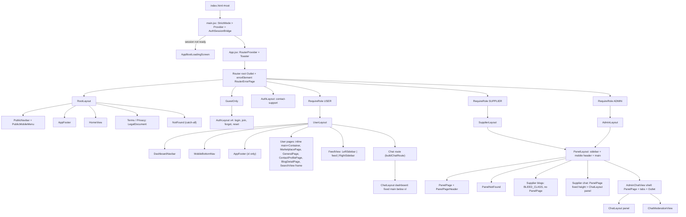
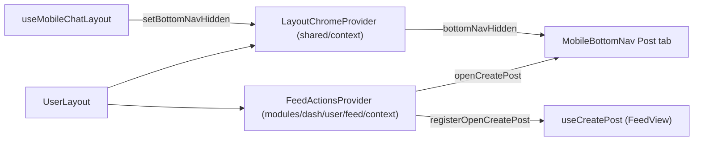

# Frontend Layout Architecture Audit

**Location note:** this report lives in `web/docs/audits/`. The task proposed
`docs/reports/`, but the frontend already keeps its audits here
(`web/docs/audits/feed-module-audit.md`, `web/docs/audits/user-module-audit.md`),
and the repository-root `docs/` folder has no `reports/` directory, so I followed
the existing convention.

**Scope:** layouts only. The audit changed no source code, styles, routes,
configuration or files. All paths below are relative to `web/`.

**Labels used in this report:**

- **[Fact]**: read directly in the cited file(s).
- **[Inferred]**: worked out from the code, but not observed at runtime.
- **[Unverified]**: an open question I could not settle.

---

## 1. Executive Summary

The app has **four route-level visual layouts**, all in `src/layouts/`:

- `RootLayout` (public);
- `AuthLayout` (auth);
- `UserLayout` (the user dashboard, with a top navbar);
- `SupplierLayout` and `AdminLayout`. These two are thin wrappers around one
  shared sidebar shell, `PanelLayout` (`src/Components/navigation/panel/PanelLayout.jsx`).

Around these sit three groups of supporting pieces:

- **Non-visual layout routes:** the router root `<Outlet/>`, the `RequireRole`
  and `GuestOnly` guards, and the chat route shell built by `buildChatRoute`.
- **Nested layout routes:** the persistent `ChatLayout` inbox and the
  `AdminChatView` tabbed shell.
- **Page-level frames:** these sit inside the route layouts.

### Overall assessment

- **The route-level layouts are clean and consistent per audience.**
  - Every role section has exactly one layout.
  - Guards are composed as pathless parent routes.
  - The two panel roles share a single shell.
- **The page-level frames are the weak spot.** They are fragmented, especially in
  the user dashboard:
  - **Admin:** every page uses `PanelPage`.
  - **Supplier:** every page uses `PanelPage` except blogs.
  - **User dashboard:** pages build their frames at least **five** different ways:
    - an inline `<main>` plus `Container`;
    - four local frame components that are almost identical;
    - a raw `max-w-6xl` frame (Search);
    - a three-column sidebar frame (Feed);
    - a bare `<main>` (Blogs).

### Main findings

1. **Duplicate `SessionCheckingFallback`.** The copy in
   `src/shared/router/guards/` is identical to the one in
   `src/Components/loader/fallbacks/` and is imported nowhere.
2. **Legacy `src/App.css`.** It is the Vite starter stylesheet, imported nowhere.
   It contains a `#root` layout rule that would break every layout if it were
   ever imported.
3. **Unused CSS variable.** `--app-container-max: 75rem` in `src/index.css` is
   referenced nowhere. Its comment claims the navbar, feed and landing sections
   follow it, but `Container` uses Tailwind's built-in `container` class instead.
4. **Four different mobile/desktop breakpoints** decide the layout chrome:
   - `sm` (640px): the bottom navigation bar;
   - `md` (768px): the Search sidebar;
   - `lg` (1024px): the panel sidebar, the public navbar and the Feed left sidebar;
   - `xl` (1280px): the dashboard navbar, the dashboard footer, the messenger and
     the Feed right sidebar.
5. **Inconsistent landmark ownership:**
   - **Panels:** `PanelLayout` owns the `<main>`, and its pages render none.
   - **User dashboard:** `UserLayout` has no `<main>`, and every user page
     renders its own.
   - **No nested `<main>` was found**, but the responsibility is reversed
     between the two dashboards.
   - **Nested `<footer>`:** `RootLayout` wraps `AppFooter`, which is already a
     `<footer>`, in another `<footer>`.
6. **Supplier blogs are copied from the user dashboard.**
   - `modules/dash/supplier/blogs/` is a near copy of `modules/dash/user/blogs/`.
   - Its pages escape `PanelLayout`'s padding with a hard-coded negative margin
     (`BLEED_CLASS = "-m-4 sm:-m-5 lg:-m-6"`), instead of using `PanelPage`.
7. **Unknown URLs in the user section fall through to the public 404 [Inferred].**
   - The user section has no `*` route.
   - A signed-in user at an unknown URL therefore gets the public
     `RootLayout`'s `NotFound`, with the public navbar.
   - Supplier and admin have their own in-panel `PanelNotFound`.
8. **Layout state is scattered:**
   - `ScrollToTop` is mounted separately in four layout components.
   - Body scroll locking is done three separate ways.
   - The user profile is fetched both in `UserLayout` and in `FeedView`.

---

## 2. Audit Scope and Methodology

### In scope

Anything that decides page structure:

- route layouts;
- guard and shell routes that render `<Outlet/>`;
- nested layout routes;
- page frames (wrappers that set `<main>`, width or padding);
- multi-column page skeletons;
- navigation chrome (navbars, sidebars, the footer and the bottom navigation bar);
- full-screen fallbacks and error screens;
- the modal overlay pattern;
- global CSS that affects layout.

### Out of scope

The contents of cards, forms, business logic and data fetching. These are
mentioned only where they affect layout.

### Method (all static analysis)

1. **Followed the mount chain:** `index.html` → `src/main.jsx` → `src/App.jsx` →
   `src/shared/router/index.jsx` → every file in `src/shared/router/routes/`.
2. **Read every layout file and every shell component:**
   - everything in `src/layouts/`;
   - the guards and `lazyPage` in `src/shared/router/`;
   - `PanelLayout`, `PanelPage`, `PanelPageHeader` and `panelPageTheme`;
   - `DashboardNavbar` and its parts, `MobileBottomNav`, `PublicNavbar`,
     `AppFooter`, `Container` and `ScrollToTop`;
   - `LayoutChromeContext` and `FeedActionsContext`;
   - `ChatLayout`, `MessagesPageContent`, `useMobileChatLayout` and `AdminChatView`;
   - the error and fallback components.
3. **Searched the code (Grep) to find every use of:**
   - `PanelPage`, `PanelPageHeader` and `PanelBackButton`;
   - `Container`;
   - each local page frame;
   - `LeftSidebar` and `RightSidebar`;
   - `ProfilePageContent` and `ContactProfilePageContent`;
   - `createPortal` and `fixed inset-0` (overlays);
   - `App.css` and `--app-container-max`.
4. **Grepped the outermost element of every page** (`pages/*.jsx`) in the user
   and supplier modules. For admin, an import count of `PanelPage` per page
   file was used.
5. **Compared every file** in `modules/dash/supplier/blogs/` with its counterpart
   in `modules/dash/user/blogs/`, using a line diff via PowerShell
   `Compare-Object`.

### Not done

- No browser, runtime or visual checks.
- No tests were run for this audit.
- No `vite build` was run for this audit.

---

## 3. Complete Layout Inventory

**Category codes:**

- **R**: route layout (renders `<Outlet/>`).
- **G**: guard or logic layout route (no markup of its own).
- **N**: nested layout route.
- **S**: shared shell (used by route layouts).
- **F**: page frame.
- **C**: composed page skeleton (multi-column).
- **E**: error, 404 or loading screen.
- **O**: overlay.
- **X**: global CSS.

| ID | Name | Cat. | File | Used by | Parent | Children | Structural elements | Rendering condition | Responsive behaviour | Key dependencies | Status |
|---|---|---|---|---|---|---|---|---|---|---|---|
| L00 | App shell | R* | `src/main.jsx`, `src/App.jsx` | `index.html` `#root` | none | the router | `StrictMode` > `Provider` > `AuthSessionBridge` > `RouterProvider` + `Toaster` | `AppBootLoadingScreen` until `sessionReady` | none | Redux store, `AuthSessionBridge` | Active |
| L01 | Router root | G | `src/shared/router/index.jsx` | every route group | L00 | L02, L03 (via `GuestOnly`), L04, L05, L06 | pathless `<Outlet/>`, `errorElement` | always | none | `RouterErrorPage` | Active |
| L02 | `RootLayout` | R | `src/layouts/RootLayout.jsx` | `public.routes.jsx` (`/`) | L01 | Home, Terms, Privacy, `*` → `NotFound` | `ScrollToTop`, `header>PublicNavbar`, `main>Outlet`, `footer>AppFooter` | public paths and every unmatched path | navbar mobile menu below `lg`; no flex column | `PublicNavbar`, `AppFooter` | Active (with issues) |
| L03 | `AuthLayout` | R | `src/layouts/AuthLayout.jsx` | `auth.routes.jsx` (5 separate route entries) | `GuestOnly` (4 routes), L01 (contact-support) | Login, Register, Forgot, Reset, ContactSupport | `min-h-screen` wrapper, `header` (72px, logo + CTA), `main>Outlet`; no footer | always for its paths | the CTA text changes on `/login` | `Container`, logo | Active |
| L04 | `UserLayout` | R | `src/layouts/UserLayout.jsx` | `user.routes.jsx` | `RequireRole[USER]` | all user pages (absolute paths) and the chat route | `FeedActionsProvider` > `LayoutChromeProvider` > flex-col `min-h-screen`: `ScrollToTop`, `DashboardNavbar`, `flex-1` Outlet wrapper, xl-only `AppFooter`, `MobileBottomNav`; no `<main>` | USER role | bottom navigation below `sm`; footer from `xl`; navbar switches at `xl` | `DashboardNavbar`, `MobileBottomNav`, `AppFooter`, `fetchUserProfile` | Active |
| L05 | `SupplierLayout` | R | `src/layouts/SupplierLayout.jsx` | `supplier.routes.jsx` (`/supplier`) | `RequireRole[SUPPLIER]` | supplier pages | `PanelLayout` with `supplierNavItems`, badges, `profilePath` | SUPPLIER role | from S01 | `PanelLayout`, `useNotificationBadge` | Active |
| L06 | `AdminLayout` | R | `src/layouts/AdminLayout.jsx` | `admin.routes.jsx` (`/admin`) | `RequireRole[ADMIN]` | admin pages | `PanelLayout` with `adminNavItems`, `profilePath="/admin/profile"` | ADMIN role | from S01 | `PanelLayout` | Active |
| S01 | `PanelLayout` | S | `src/Components/navigation/panel/PanelLayout.jsx` | L05, L06 | L05/L06 | `children` (the Outlet) | flex `min-h-screen`; fixed 260px `aside` (`z-50`); desktop spacer; overlay `z-40`; mobile sticky `header` `h-14`; `main` with `p-4 sm:p-5 lg:p-6` | always under L05/L06 | sidebar is a drawer below `lg` and fixed from `lg` | `useAuth`, `useUnreadMessages`, `ScrollToTop` | Active (lint errors) |
| G01 | `RequireRole` | G | `src/shared/router/guards/RequireRole.jsx` | user, supplier and admin routes | L01 | L04/L05/L06 | `SessionCheckingFallback` or `Navigate` or `<Outlet/>` | session-ready and role checks | none | `useAuth` | Active |
| G02 | `GuestOnly` | G | `src/shared/router/guards/GuestOnly.jsx` | `auth.routes.jsx` | L01 | 4 × L03 | as for G01 | signed in → redirects to `homePath` | none | `useAuth` | Active |
| N01 | Chat route shell | N | `src/shared/router/routes/chat.routes.jsx` (`buildChatRoute`) | user (`/chat`), supplier (`chat`), admin (`chat`) | L04/S01 | index `ChatRedirect`; inbox layout route → 4 section routes (`element: null`); extras; `*` | optional `shell` element | always | none | `ChatRedirect` | Active |
| N02 | `ChatLayout` | N | `src/modules/messages/route/ChatLayout.jsx` | `MessagesView`, `SupplierMessagesView`, `AdminChatInboxView` | N01 | section routes (params only) | `MessagesContainer` → `MessagesPageContent` + modals | chat routes | from F09 | `useChatRoute` | Active |
| N03 | `AdminChatView` | N | `src/modules/dash/admin/messages/pages/AdminChatView.jsx` | admin `chat` route `shell` | S01 | inbox (N02), moderation | `PanelPage` (viewport-height calc), `PanelPageHeader` + `SegmentedTabs`, `Outlet` | admin chat | height calc switches at `lg` | `PanelPage` | Active |
| F01 | `PanelPage` (+ `PanelPageHeader`, `panelPageTheme`) | F | `src/Components/navigation/panel/PanelPage.jsx`, `PanelPageHeader.jsx`, `panelPageTheme.js` | every admin page; every supplier page except blogs | S01 | page content | `div.space-y-4` + width preset (`full`, `narrow` 760, `small` 880, `wide` 1160) | always | header row from `sm` | none | Active |
| F02 | `Container` | F | `src/Components/ui/Container.jsx` (imported as `@/components/ui/Container`) | 32 files (public, auth, user, supplier blogs, navbars, footer, messenger) | various | content | `mx-auto w-full container px-4 sm:px-6 lg:px-8` | always | Tailwind container steps | none | Active |
| F03 | Inline `<main>` + `Container` | F | user `pages/*.jsx`: Subscription, Recruitment ×4, Profile, ProfileSetup, Notifications, Contacts, Feed | those pages | L04 | page content | `<main className="py-…">` + `Container max-w-…` | always | per page | `Container` | Active (repeated pattern) |
| F04 | `MarketplacePage` | F | `src/modules/dash/user/marketplace/components/layout/MarketplacePage.jsx` | 5 marketplace pages | L04 | content + `overlays` | `main` > `Container` + overlays | always | none | `Container` | Active (near-duplicate) |
| F05 | `GeneralPage` | F | `src/modules/dash/user/general/components/layout/GeneralPage.jsx` | 3 general pages | L04 | content | `main.pt-6.pb-8` > `Container` | always | none | `Container` | Active (near-duplicate) |
| F06 | `ContactProfilePage` | F | `src/modules/dash/user/contacts/components/profile/ContactProfilePage.jsx` | `ContactProfileView` | L04 | content | `main` > `Container max-w-7xl` | always | none | `Container` | Active (near-duplicate) |
| F07 | `BlogDetailPage` (user) | F | `src/modules/dash/user/blogs/components/layout/BlogDetailPage.jsx` | `BlogDetailView` | L04 | content | `main` > `div.py` > `Container max-w-[960px]` | always | none | `Container` | Active |
| F08 | `BlogDetailPage` (supplier) | F | `src/modules/dash/supplier/blogs/components/layout/BlogDetailPage.jsx` | `SupplierBlogDetailView` | S01 | content | `div` with `BLEED_CLASS` > `div.py` > `Container max-w-[960px]` | always | negative margins mirror S01 padding | `Container`, `BLEED_CLASS` | Duplicated |
| F09 | `MessagesPageContent` | F | `src/modules/messages/components/layout/MessagesPageContent.jsx` | N02 | N02 | `Messenger` | **dashboard variant:** `main` fixed `top-14 z-20` … `xl:static`; **panel variant:** `div.flex.min-h-0.flex-1.flex-col` | by `variant` | dashboard variant is fixed below `xl` with bottom offset for the navigation bar; panel variant fills its parent | `Container`, `useMobileChatLayout` | Active |
| F10 | `SupplierMessagesView` frame | F | `src/modules/dash/supplier/messages/pages/SupplierMessagesView.jsx` | supplier chat inbox | N01 | N02 | `PanelPage className="flex h-[calc(100dvh-5.5rem)] flex-col lg:h-[calc(100dvh-3rem)]"` | always | `lg` | `PanelPage` | Active (magic numbers) |
| F11 | Search frame | F | `src/modules/dash/user/search/pages/SearchView.jsx` | Search | L04 | filter sidebar + results | `main.mx-auto.max-w-6xl.px-4.py-6.md:flex-row` | sidebar only when there is a query | becomes two columns at `md` | none (no `Container`) | Active (inconsistent) |
| F12 | Blogs hub frame | F | user `BlogsView.jsx`, supplier `SupplierBlogsView.jsx` | blog hubs | L04 / S01 | Hero, Latest, Archive | user: bare `main`; supplier: `BLEED_CLASS` div | always | sections use `Container` | hub components | Duplicated |
| F13 | `LegalDocument` | F | `src/modules/public/legal/components/LegalDocument.jsx` | Terms, Privacy | L02 | header, table of contents, article | `section` > `Container` > `max-w-7xl` grid | always | two columns at `lg` | `Container` | Active |
| C01 | Feed three-column | C | `src/modules/dash/user/feed/pages/FeedView.jsx` + `src/Components/navigation/components/{left,right}-sidebar/*` | `/feed` | L04 | `LeftSidebar`, feed column, `RightSidebar` | `main` > `Container.flex.gap-8` | left sidebar from `lg`, right from `xl` | sticky sidebars at `top-[70px]` | `useRightSidebar`, Redux | Active |
| C02 | `ProfilePageContent` | C | `src/Components/data-display/ProfilePageContent/ProfilePageContent.jsx` | `ProfileView` (sidebar mode), `AdminUserDetailView` (`threeColumn`) | F03 / F01 | hero, cards, activity | three branches: single column, two-column `lg` grid, three-column `xl`/`2xl` grid | by props | `lg`, `xl`, `2xl` | `ProfileHero`, `ActivitySection` | Active (complex) |
| C03 | `ContactProfilePageContent` | C | `src/Components/data-display/ContactProfilePageContent/ContactProfilePageContent.jsx` | `ContactProfileView` (user), `SupplierContactProfileView` | F06 / F01 | hero, cards, activity | `lg` two-column grid with `order` rules | always | `lg` | `ContactProfileHero` | Active |
| E01 | `RouterErrorPage` | E | `src/modules/error/RouterErrorPage.jsx` | root `errorElement` | L01 | none | full-screen `section.min-h-screen` | errors thrown while routing | none | none | Active |
| E02 | `NotFound` | E | `src/modules/error/NotFound.jsx` | public `*` | L02 | none | `min-h` computed from the public navbar heights + 80px | unmatched paths | `lg`/`xl` heights | none | Active (coupled) |
| E03 | `PanelNotFound` | E | `src/modules/error/PanelNotFound.jsx` | supplier and admin `*` | S01 | none | dashed card | unmatched panel paths | none | `useAuth` | Active |
| E04 | `PageLoadingFallback` | E | `src/Components/loader/fallbacks/PageLoadingFallback.jsx` | `lazyPage` (Suspense) | the parent layout | none | `min-h-[40vh]` centred | while a lazy chunk loads | none | none | Active |
| E05 | `SessionCheckingFallback` | E | `src/Components/loader/fallbacks/SessionCheckingFallback.jsx` | `RequireRole`, `GuestOnly`; re-exported by `guards/index.js` | G01/G02 | none | `min-h-[40vh]` centred text | session not ready | none | none | Active |
| E06 | `SessionCheckingFallback` (guards copy) | E | `src/shared/router/guards/SessionCheckingFallback.jsx` | **nothing** | none | none | identical to E05 | never | none | none | **Duplicated / unused** |
| E07 | `AppBootLoadingScreen` | E | `src/Components/loader/screens/AppBootLoadingScreen.jsx` | `AuthSessionBridge` | L00 | none | `fixed inset-0 z-[9999]` | before the session is ready | none | none | Active |
| O01 | Modal overlay pattern | O | ~25 files under `src/Components/modals/**`, plus `ImageViewer` | feature pages | any | dialog | inline `fixed inset-0 z-[100/110/200/210]`; a few use `createPortal` | `open` prop | many are a bottom sheet below `sm` and centred from `sm` | none (no shared base) | Active (no shared primitive) |
| X01 | `src/App.css` | X | `src/App.css` | **nothing** | none | none | `#root { max-width:1280px; padding:2rem; text-align:center }` | never loaded | none | none | **Legacy / unused** |
| X02 | `--app-container-max` | X | `src/index.css` (line 72) | **nothing** | none | none | `:root` custom property `75rem` | never referenced | none | none | **Legacy / unused** |
| X03 | `index.css` globals | X | `src/index.css` | `main.jsx` | none | none | Tailwind `@theme` (colours, animations), `html { scroll-behavior: smooth }`, scrollbar utilities | always | no custom breakpoints | Tailwind v4 | Active |

\* L00 is not a router layout, but it is the outermost frame that every layout renders inside.

---

## 4. Detailed Analysis of Every Layout

### L00: App shell

- **[Fact]** `index.html` has only `<div id="root">`.
- **[Fact]** `src/main.jsx` mounts `StrictMode` > `Provider store` >
  `AuthSessionBridge` > `App`. The bridge renders `AppBootLoadingScreen` until
  the session is ready.
- **[Fact]** `src/App.jsx` renders `<RouterProvider router={router}/>` and a
  sibling `<Toaster position="bottom-right"/>`.
- **[Inferred]** Every route layout therefore starts only after the session has
  been revalidated. Because of that, the `SessionCheckingFallback` inside the
  guards should rarely, if ever, appear on first load.

### L01: Router root

- **[Fact]** `src/shared/router/index.jsx` defines a pathless
  `{ element: <Outlet/>, errorElement: <RouterErrorPage/> }`. Its children are
  `publicRoutes`, `...authRoutes`, `userRoutes`, `adminRoutes` and
  `supplierRoutes`.
- **[Fact]** Because there is a single `errorElement` at the root, any error
  thrown while routing replaces the whole UI, including the navbars, with a
  full-screen `RouterErrorPage`. No layout has its own `errorElement`.

### L02: `RootLayout` (public)

- **[Fact]** The markup is a fragment containing:
  - `ScrollToTop`;
  - `<header><PublicNavbar/></header>`;
  - `<main><Outlet/></main>`;
  - `<footer><AppFooter/></footer>`.
- **[Fact]** `AppFooter` itself renders `<footer className="mt-auto …">`. The
  result is a `<footer>` nested inside a `<footer>`, and `mt-auto` has no effect
  because the parent is not a flex column. On short pages the footer is not
  pinned to the bottom of the viewport.
  - `NotFound` works around this by giving itself a `min-h` equal to
    `100vh - navbar - 80px`.
- **[Fact]** `PublicNavbar` (`src/Components/navigation/components/public-navbar/PublicNavbar.jsx`):
  - a sticky `nav`, `z-[70]`;
  - heights `h-[72px] lg:h-[76px] xl:h-[84px]`;
  - desktop links from `lg`;
  - below `lg`, `PublicMobileMenu` (fixed, `top-[72px]`, overlay `z-[60]`).
- **[Fact]** Children: index `HomeView`; `/terms`; `/privacy`; `*` → `NotFound`.

### L03: `AuthLayout`

- **[Fact]** Structure: a `min-h-screen bg-[#F7F8FA]` wrapper, `ScrollToTop`,
  a white `header` with a 72px `Container` (logo plus a CTA line), then
  `<main><Outlet/></main>`. There is no footer.
- **[Fact]** The CTA reads "New here? Join Lab Unity" when
  `pathname === '/login'`. Otherwise it reads "Already have an account? Sign In",
  and that includes `/contact-support`.
- **[Fact]** `src/shared/router/routes/auth.routes.jsx` declares
  `element: <AuthLayout/>` **five times**, one per path, each with its own index
  child. Each sibling route has its own `AuthLayout` element, so
  **[Inferred]** React Router may remount `AuthLayout` when moving between
  `/login` and `/join`. A single pathless `AuthLayout` parent would keep the
  instance mounted.
- **[Fact]** `CONTACT_SUPPORT_PATH` sits outside `GuestOnly`, so it is reachable
  whether or not the user is signed in. This looks intentional, since suspended
  users need to reach it.

### L04: `UserLayout`

- **[Fact]** Providers: `FeedActionsProvider` (from the feed module) wraps
  `LayoutChromeProvider` (from `src/shared/context/`).
- **[Fact]** Chrome, in order:
  - `div.flex.min-h-screen.flex-col.bg-[#F3F4F6]`;
  - `ScrollToTop`;
  - `DashboardNavbar`;
  - `div.flex-1` containing the Outlet, with bottom padding equal to the
    bottom-bar height (`3.5rem`) plus the safe-area inset, `sm:pb-0`;
  - `div.hidden.xl:block` containing `AppFooter`;
  - `MobileBottomNav`.
- **[Fact]** `UserLayout` renders **no `<main>`**. Each page supplies its own:
  - the F03/F04/F05/F06/F07 frames, `SearchView`, `BlogsView` and `FeedView`
    all render `<main>`;
  - the dashboard messenger (F09) also renders `<main>`.
- **[Fact]** `DashboardNavbar`:
  - `header`, sticky, `z-[70]`;
  - `MobileHeader` is `h-14 xl:hidden`;
  - `DesktopHeader` is `Container hidden h-[62px] xl:flex`;
  - `MobileMenuDrawer` is fixed at `top-14`, overlay `z-[60]`, drawer `z-[65]`,
    `xl:hidden`;
  - it uses `useBodyScrollLock`.
- **[Fact]** `MobileBottomNav`:
  - fixed at the bottom, `h-14`, `z-50`, `sm:hidden`;
  - returns `null` when `LayoutChromeContext.bottomNavHidden` is true;
  - its Post tab calls `FeedActionsContext.openCreatePost`. If the feed has
    registered an opener, that opener runs; otherwise the provider navigates to
    `/feed` and opens the dialog once `useCreatePost` registers.
- **[Fact]** `UserLayout` dispatches `fetchUserProfile()` when there is no
  user, and so does `FeedView`. The fetch logic is duplicated.
- **[Fact]** The user routes use **absolute** child paths (`/feed`, `/search`,
  …) under a pathless `RequireRole` → `UserLayout` pair. There is no `*` child.

### L05/L06 and S01: `SupplierLayout`, `AdminLayout` and `PanelLayout`

- **[Fact]** Both route layouts are one-liners that pass role-specific
  `navItems`, `badgeCounts` (supplier only) and `profilePath` into
  `PanelLayout`.
- **[Fact]** `PanelLayout` markup:
  - root `div.flex.min-h-screen`;
  - `ScrollToTop`;
  - mobile overlay `button` (`z-40`, `lg:hidden`);
  - fixed `aside` (260px, `z-50`): a translate drawer below `lg`, always visible
    from `lg`;
  - a desktop spacer `div` of the same width;
  - a column holding a sticky mobile `header` (`h-14`, `z-30`, `lg:hidden`) and
    `<main className="min-h-[calc(100vh-3.5rem)] flex-1 p-4 sm:p-5 lg:min-h-screen lg:p-6">`.
- **[Fact]** Sidebar content: logo, "Main menu" `NavLink`s with `CountBadge`,
  an account card with a settings link, and a Logout button.
- **[Fact]** It closes the drawer on path change with `setSidebarOpen(false)`
  inside an effect (lines 32–34), which ESLint flags as
  `react-hooks/set-state-in-effect`. `icon: Icon` is also flagged as
  unused-var. Both are pre-existing lint errors.
- **[Fact]** Body scroll lock is implemented inline (lines 36–42), separately
  from `useBodyScrollLock`.
- **[Fact]** The file lives in `src/Components/navigation/panel/`, not
  `src/layouts/`, even though it is a layout shell.
- **[Fact]** The panel shell has no footer, unlike `UserLayout`.

### G01/G02: guards

- **[Fact]** `RequireRole`:
  - shows `SessionCheckingFallback` until the session is ready;
  - with no session, redirects to `/login` with `state.from`;
  - for the wrong role, redirects to the role's home path, or to the
    `handle.roleRedirect`-mapped equivalent (used by chat);
  - otherwise renders `<Outlet/>`.
- **[Fact]** `GuestOnly` redirects signed-in users to `homePath`.
- **[Fact]** Both import the fallback from
  `@/components/loader/fallbacks/SessionCheckingFallback`.
  `src/shared/router/guards/index.js` re-exports that same loader component.

### N01/N02/N03: chat layouts

- **[Fact]** `buildChatRoute({ path, shell?, inbox, extraRoutes })` returns
  `{ path, element: shell?, handle, children }`. Its children are:
  - index `ChatRedirect`;
  - a **pathless layout route** `{ element: inbox, children: chatSectionRoutes }`;
  - the extra routes;
  - `*` → `ChatRedirect`.
- **[Fact]** The four section routes (`messages`, `messages/:userId`, `group`,
  `group/:groupId`) have `element: null`. They exist only to supply params to
  the persistent inbox, which never renders an `<Outlet/>`. This keeps the
  messenger mounted while the user switches conversations.
- **[Fact]** The inbox element differs per role:
  - **User:** `MessagesView` → `ChatLayout variant="dashboard"`.
  - **Supplier:** `SupplierMessagesView` → `PanelPage` (fixed viewport height) →
    `ChatLayout variant="panel"`.
  - **Admin:** `AdminChatInboxView` → `ChatLayout variant="panel"`, inside the
    `AdminChatView` **shell**. The shell is a `PanelPage` with the same height
    calc, plus a `PanelPageHeader` with `SegmentedTabs` and an `<Outlet/>`.
    Admin also adds `moderation` → `ChatModerationView` as an extra route.
- **[Fact]** `ChatLayout` is imported inconsistently:
  - `MessagesView` and `AdminChatInboxView` import it by file path;
  - `SupplierMessagesView` imports through the `@/modules/messages` index.
- **[Fact]** `legacyChatRoute('/messages')` and the supplier `messages` route
  render `LegacyChatRedirect`.

### F01: `PanelPage` and `PanelPageHeader`

- **[Fact]** `PanelPage` renders a `div` with `space-y-4` plus a width preset
  from `panelPageWidths`.
- **[Fact]** `PanelPageHeader` is a flex row from `sm` (title and subtitle on
  one side, optional action on the other), using `panelPageTheme.title` and
  `panelPageTheme.subtitle`.
- **[Fact]** Usage:
  - **Admin:** every page file under `modules/dash/admin/*/pages/` imports
    `PanelPage` (21 files counted).
  - **Supplier:** every page except `SupplierBlogsView` and
    `SupplierBlogDetailView`.

### F02/F03–F07, F11, F12: user page frames

- **[Fact]** `Container` sets `mx-auto w-full container px-4 sm:px-6 lg:px-8`.
  Most pages narrow it further with `max-w-…`.
- **[Fact]** These local frames all reduce to `<main className="py…"><Container className=…/></main>`:
  - `MarketplacePage`;
  - `GeneralPage`;
  - `ContactProfilePage`;
  - user `BlogDetailPage`;
  - the inline frames in Subscription, Recruitment ×4, Profile, ProfileSetup,
    Notifications and Contacts.

  They differ only in vertical padding. The values found are `pt-6 pb-5 sm:pt-8
  sm:pb-8`, `pt-6 pb-8 sm:pt-8`, `py-6 sm:py-8`, `py-6 sm:py-10`, `py-4 sm:py-5`,
  and `py-5 sm:py-8` (on an inner `div`). Widths vary too: `max-w-[760px]`,
  `max-w-[920px]`, `max-w-[960px]`, `max-w-6xl` and `max-w-7xl`.
- **[Fact]** `SearchView` does not use `Container`. It hand-codes
  `mx-auto max-w-6xl px-4 py-6`, so its horizontal padding stays at `px-4` on
  every breakpoint, whereas `Container` grows to `sm:px-6 lg:px-8`.
- **[Fact]** User `BlogsView` renders a bare `<main>`. Each hub section
  supplies its own `Container`.

### F08/F12: supplier blogs

- **[Fact]** Supplier `BlogDetailPage` and `SupplierBlogsView` wrap their
  content in `BLEED_CLASS = "-m-4 sm:-m-5 lg:-m-6"` (from
  `modules/dash/supplier/blogs/constant/constants.js`). Its comment says it
  "Cancels the dashboard panel padding".
- **[Inferred]** This hard-codes `PanelLayout`'s `<main>` padding
  (`p-4 sm:p-5 lg:p-6`). If that padding changes, the supplier blog pages will
  break silently.
- **[Fact]** File comparison, supplier against user `blogs/`:
  - the 14 files that exist in both differ by 4–46 lines each;
  - the doc and test files differ more;
  - only the two pages and one test exist only in the supplier folder.
  - In short, the supplier blog module is a lightly edited copy.

### F09/F10: messenger frame

- **[Fact]** Dashboard variant:
  - `<main className="fixed inset-x-0 top-14 z-20 … xl:static xl:block xl:py-8">`;
  - bottom offset is `bottom-0` when a chat panel is open, otherwise
    `bottom-[calc(3.5rem+safe)] sm:bottom-0`;
  - contains `Container max-xl:!px-0` > `Messenger`.
- **[Fact]** `useMobileChatLayout`:
  - uses its own `MOBILE_QUERY = '(max-width: 1279px)'`;
  - dashboard variant only: while a conversation is open, sets
    `bottomNavHidden` and locks scrolling on `html` and `body`.
- **[Fact]** Panel variant: `div.flex.min-h-0.flex-1.flex-col`. It depends on
  the parent `PanelPage` having a fixed height:
  - `h-[calc(100dvh-5.5rem)]` = mobile header 3.5rem + `p-4` × 2;
  - `lg:h-[calc(100dvh-3rem)]` = `lg:p-6` × 2.
- **[Inferred]** These magic numbers are tied to `PanelLayout` in the same way
  as `BLEED_CLASS`.
- **[Unverified]** At `sm` (640–1023px) `PanelLayout` uses `p-5`
  (2.5rem vertically), but the height calc assumes `p-4` (2rem). The chat panel
  may therefore be 0.5rem taller than the space available at `sm`. This was not
  checked visually.

### C01: Feed three-column

- **[Fact]** `FeedView` renders `main.py-4` > `Container.flex.gap-8` >
  `LeftSidebar`, feed `section`, `RightSidebar`.
- **[Fact]** `LeftSidebar` is `hidden w-[320px] lg:block`, with a sticky inner
  block at `top-[70px]`. `RightSidebar` is `hidden w-[320px] xl:block` and also
  sticky at `top-[70px]`.
- **[Inferred]** The 70px offset does not match the navbar it sits under:
  - from `xl` the navbar is 62px tall, leaving an 8px gap, which may be
    intentional;
  - between `lg` and `xl` the mobile header is 56px tall, leaving a 14px gap.

### C02/C03: profile skeletons

- **[Fact]** `ProfilePageContent` has three layout branches:
  - default: one column;
  - `sidebarSlot`: an `lg` two-column grid;
  - `threeColumn`: an `xl` two-column grid that becomes three columns at `2xl`.
- **[Fact]** Users:
  - `ProfileView` (user) uses the `sidebarSlot` branch;
  - `AdminUserDetailView` uses `threeColumn`;
  - the default branch has no caller in `pages/`.
- **[Fact]** `ContactProfilePageContent` is a fixed `lg` two-column grid that
  reorders its cards on mobile. It is shared by the user and supplier
  contact-profile pages.

### E01–E07: error and loading screens

- **[Fact]** `RouterErrorPage` is full-screen (`min-h-screen`), with no chrome.
- **[Fact]** `NotFound` sizes itself from the public navbar heights
  (72/76/84px) plus an assumed 80px footer.
- **[Fact]** `PanelNotFound` is a card rendered inside the panel `<main>`.
- **[Fact]** `PageLoadingFallback` and `SessionCheckingFallback` are each
  `min-h-[40vh]` centred blocks.
- **[Fact]** `AppBootLoadingScreen` is `fixed inset-0 z-[9999]`.

### O01: modal overlays

- **[Fact]** About 25 modal components each hand-write their overlay as
  `fixed inset-0 … flex …`. There is no shared `Modal` primitive.
- **[Fact]** z-index values in use: `z-[100]`, `z-[110]` (`ImageViewer`),
  `z-[200]` and `z-[210]` (`AddMembersModal`, stacked above
  `ConversationInfoModal`).
- **[Fact]** Backdrops vary: `bg-black/50`, `/80` and `/90`.
- **[Fact]** Only `CreateAdModal`, `SharePostModal`, `FullCommentsModal` and
  `DataTable` use `createPortal`. The rest render in place inside the page tree.
- **[Inferred]** Rendering in place works today because nothing between the
  page and the viewport creates a stacking context or a transform, apart from
  the supplier and admin sidebar `aside`, which is a sibling and not an
  ancestor.

---

## 5. Layout-to-Route Mapping

Source files: `src/shared/router/routes/*.routes.jsx`.

| URL pattern | Guard | Route layout | Nested layout(s) | Page frame |
|---|---|---|---|---|
| `/` | none | `RootLayout` | none | home sections (`Container`) |
| `/terms`, `/privacy` | none | `RootLayout` | none | `LegalDocument` |
| `/login`, `/join`, `/forgot-password`, `/reset-password` | `GuestOnly` | `AuthLayout` (one per route) | none | page markup |
| `/contact-support` (`CONTACT_SUPPORT_PATH`) | none | `AuthLayout` | none | page markup |
| `/feed` | `RequireRole[USER]` | `UserLayout` | none | C01 Feed three-column |
| `/search` | same | `UserLayout` | none | F11 |
| `/contacts` | same | `UserLayout` | none | F03 |
| `/contacts/:contactId` | same | `UserLayout` | none | F06 + C03 |
| `/marketplace`, `/saved`, `/my-listings`, `/create`, `/:listingId/edit`, `/:listingId` | same | `UserLayout` | none | F04 |
| `/recruitment`, `/my-jobs`, `/create`, `/:jobId/edit`, `/:jobId` | same | `UserLayout` | none | F03 |
| `/general`, `/general/my-posts`, `/general/:postId` | same | `UserLayout` | none | F05 |
| `/blogs` | same | `UserLayout` | none | F12 (bare `main`) |
| `/blogs/:slug` | same | `UserLayout` | none | F07 |
| `/notifications`, `/subscription`, `/profile/edit` | same | `UserLayout` | none | F03 |
| `/profile` | same | `UserLayout` | none | F03 + C02 (`sidebarSlot`) |
| `/chat/**` | same | `UserLayout` | N01 → N02 (dashboard) | F09 dashboard variant |
| `/messages` (legacy), `/dashboard` | same | `UserLayout` | none | redirect only |
| unknown non-panel path | none | `RootLayout` **[Inferred]** | none | E02 `NotFound` |
| `/supplier` (index) | `RequireRole[SUPPLIER]` | `SupplierLayout` → `PanelLayout` | none | F01 |
| `/supplier/ads[/:adId]`, `general/**`, `contacts`, `recruitment/**`, `notifications`, `profile` | same | same | none | F01 |
| `/supplier/contacts/:contactId` | same | same | none | F01 + C03 |
| `/supplier/chat/**` | same | same | N01 → F10 → N02 (panel) | F09 panel variant |
| `/supplier/blogs`, `/supplier/blogs/:slug` | same | same | none | F12 / F08 (`BLEED_CLASS`, no `PanelPage`) |
| `/supplier/*` | same | same | none | E03 |
| `/admin` (index) and every listed admin path | `RequireRole[ADMIN]` | `AdminLayout` → `PanelLayout` | none | F01 |
| `/admin/users/:userId` | same | same | none | F01 + C02 (`threeColumn`) |
| `/admin/chat/**` | same | same | N01 with N03 shell → N02 (panel) | F09 panel variant |
| `/admin/chat/moderation` | same | same | N01 → N03 | `ChatModerationView` |
| `/admin/*` | same | same | none | E03 |
| any error thrown while routing | none | none (replaces the whole tree) | none | E01 |

---

## 6. Layout Hierarchy and Mermaid Diagram



### Context providers that layouts mount



---

## 7. Shared Layout Components and Dependencies

| Component | File | Used by layouts / frames | Notes |
|---|---|---|---|
| `Container` | `src/Components/ui/Container.jsx` | `AuthLayout`, `PublicNavbar`, `PublicMobileMenu`, `DesktopHeader`, `AppFooter`, `MessagesPageContent`, `LegalDocument`, home sections, 10 user pages, 4 user frames, supplier blogs | the de-facto width primitive; `--app-container-max` is not wired into it |
| `ScrollToTop` | `src/Components/common/scrolls/ScrollToTop.jsx` | `RootLayout`, `AuthLayout`, `UserLayout`, `PanelLayout` | mounted 4 times; could live once at the router root |
| `AppFooter` | `src/Components/navigation/footer/AppFooter.jsx` | `RootLayout` (inside an extra `<footer>`), `UserLayout` (`xl` only) | not in `AuthLayout` or `PanelLayout` |
| `PublicNavbar` | `src/Components/navigation/components/public-navbar/` | `RootLayout` | `lg` breakpoint |
| `DashboardNavbar` | `src/Components/navigation/components/navbar/` | `UserLayout` | `xl` breakpoint |
| `MobileBottomNav` | `src/Components/navigation/components/bottom-nav/MobileBottomNav.jsx` | `UserLayout` | `sm` breakpoint; depends on two contexts |
| `LeftSidebar`, `RightSidebar` | `src/Components/navigation/components/{left,right}-sidebar/` | `FeedView` only | `lg` / `xl` |
| `PanelLayout` | `src/Components/navigation/panel/PanelLayout.jsx` | `SupplierLayout`, `AdminLayout` | a layout shell stored under `Components/navigation` |
| `PanelPage`, `PanelPageHeader`, `PanelBackButton`, `panelPageTheme` | `src/Components/navigation/panel/` | admin and supplier pages, `AdminChatView` | the panel page-frame system |
| `LayoutChromeContext` | `src/shared/context/LayoutChromeContext.jsx` | `UserLayout` (provider), `MobileBottomNav`, `useMobileChatLayout` | user dashboard only |
| `FeedActionsProvider` | `src/modules/dash/user/feed/context/FeedActionsContext.jsx` | `UserLayout`, `MobileBottomNav`, `useCreatePost` | **layout depends on a feature module** |
| `RequireRole`, `GuestOnly`, `lazyPage` | `src/shared/router/guards/`, `src/shared/router/utils/lazyPage.jsx` | role and auth routes | `lazyPage` wraps each user page in `Suspense` + `PageLoadingFallback` |
| `PageLoadingFallback`, `SessionCheckingFallback` | `src/Components/loader/fallbacks/` | `lazyPage`, guards | a duplicate fallback exists in `guards/` |
| `ProfilePageContent`, `ContactProfilePageContent` | `src/Components/data-display/` | user and admin profile pages, user and supplier contact profiles | the multi-column skeletons |

### Dependency direction notes

- **[Fact]** `src/layouts/UserLayout.jsx` imports `@/modules/dash/user/feed/context/FeedActionsContext`.
- **[Fact]** `src/Components/navigation/components/bottom-nav/MobileBottomNav.jsx`
  imports `@/modules/dash/user/feed/hooks/useFeedActions`.
- **[Inferred]** Together these make shared layout code depend on a feature
  module, the reverse of the usual direction.

---

## 8. Responsive and Conditional Layout Behavior

### Breakpoints that switch layout chrome

Tailwind defaults apply, because `@theme` in `src/index.css` defines no
custom breakpoints.

| Breakpoint | What switches | Where |
|---|---|---|
| `sm` 640px | `MobileBottomNav` hides; `UserLayout` drops its bottom padding; most modals switch from bottom sheet to centred; `PanelPageHeader` becomes a row | `MobileBottomNav.jsx`, `UserLayout.jsx`, `Components/modals/**`, `PanelPageHeader.jsx` |
| `md` 768px | Search becomes two columns | `SearchView.jsx` |
| `lg` 1024px | panel sidebar becomes fixed (no drawer); panel mobile header hides; `PublicNavbar` shows desktop links; Feed `LeftSidebar` appears; profile skeletons switch to two columns; legal page gets two columns | `PanelLayout.jsx`, `PublicNavbar.jsx`, `LeftSidebar.jsx`, `ProfilePageContent.jsx`, `ContactProfilePageContent.jsx`, `LegalDocument.jsx` |
| `xl` 1280px | `DashboardNavbar` switches from mobile header to desktop header; user footer appears; Feed `RightSidebar` appears; messenger switches from fixed full-screen to static; `ProfilePageContent` `threeColumn` grid | `DashboardNavbar` parts, `UserLayout.jsx`, `RightSidebar.jsx`, `MessagesPageContent.jsx`, `useMobileChatLayout.js` (`max-width: 1279px`) |
| `2xl` 1536px | `threeColumn` profile gets its third column | `ProfilePageContent.jsx` |

**[Inferred] Consequences:**

- **User dashboard between 640px and 1279px:** there is no bottom navigation bar
  and no footer, and the navbar is still the mobile header. Navigation happens
  only through the hamburger drawer.
- **Feed between 1024px and 1279px:** the mobile header is shown together with
  the desktop-style left sidebar.

### Conditional rendering inside layouts

- **[Fact]** `AuthLayout` changes its CTA text by `pathname === '/login'`.
- **[Fact]** `MobileBottomNav` is hidden when `bottomNavHidden` is true. Only
  the dashboard messenger sets it, below 1280px, while a conversation is open.
- **[Fact]** `MessagesPageContent` drops its bottom offset when the chat panel
  is open.
- **[Fact]** `PanelLayout` shows a red dot on the hamburger button when any nav
  badge is above 0, and shows the profile-settings link only if `profilePath`
  is set.
- **[Fact]** `SearchView` renders its filter sidebar only when a query exists.
- **[Fact]** `UserLayout` and `FeedView` fetch the profile when it is missing.

### Scroll locking (three implementations)

- `useBodyScrollLock`, used by `DashboardNavbar`.
- Inline `document.body.style.overflow` in `PanelLayout`.
- `html` + `body` locking in `useMobileChatLayout`.

**[Unverified]** These have not been tested together. One concrete risk: if two
locks overlap, whichever releases first could restore scrolling while the other
lock is still meant to be active.

### Sticky and fixed z-index stack

| z-index | Element(s) |
|---|---|
| 20 | dashboard messenger `main` (below 1280px) |
| 30 | panel mobile header |
| 40 | panel overlay |
| 50 | panel `aside`, `MobileBottomNav` |
| 60 | navbar overlays |
| 65 | dashboard drawer |
| 70 | `PublicNavbar`, `DashboardNavbar` |
| 100–210 | modals |
| 9999 | boot screen |

**[Fact]** There is no z-index scale token; every value is an arbitrary literal.

---

## 9. Duplicate, Legacy, Unused, and Uncertain Layouts

### Duplicated

1. **`src/shared/router/guards/SessionCheckingFallback.jsx`** is
   byte-for-byte equivalent to
   `src/Components/loader/fallbacks/SessionCheckingFallback.jsx`, and imported
   nowhere. `guards/index.js` re-exports the loader version.
2. **Supplier blogs** (`src/modules/dash/supplier/blogs/**`) are a near-copy of
   `src/modules/dash/user/blogs/**`, including both `BlogDetailPage` frames.
   The only meaningful layout difference is `BLEED_CLASS` versus `<main>`.
3. **User page frames.** `MarketplacePage`, `GeneralPage`, `ContactProfilePage`,
   the user `BlogDetailPage` and about ten inline `<main><Container>` blocks all
   repeat one pattern, differing only in padding and max width (see the
   F02/F03–F07 analysis in Section 4).
4. **`AuthLayout` is declared five times** in `auth.routes.jsx` instead of once
   as a pathless parent.
5. **`ScrollToTop`** is mounted in four layout components.
6. **Body scroll locking** has three implementations (see Section 8).
7. **Profile fetching.** `fetchUserProfile` is dispatched in both `UserLayout`
   and `FeedView`.
8. **Modal overlay markup** is written by hand in about 25 files, with no shared
   primitive.

### Legacy / unused

1. **`src/App.css`.** Vite starter CSS, imported nowhere. If imported, its
   `#root` rule (max width 1280px, 2rem padding, centred text) would break every
   layout.
2. **`--app-container-max: 75rem`** in `src/index.css`. Defined, never
   referenced. Its comment is misleading.
3. **`ProfilePageContent` default branch** (no `sidebarSlot` and no
   `threeColumn`). No page in `pages/` uses it. **[Unverified]** It may be used
   by tests or skeletons.

### Inconsistent

1. **Nested landmarks:**
   - `RootLayout` puts `<footer>` around `AppFooter`, which is itself a
     `<footer>`.
   - Inside the panels, pages render no `<main>`, which is correct because
     `PanelLayout` owns it.
   - Inside `UserLayout`, pages own the `<main>`. This works, but the
     responsibility is reversed compared with the panels.
2. **The `RootLayout` footer is not pinned.** There is no flex column, so
   `AppFooter`'s `mt-auto` is inert. `NotFound` compensates with a hard-coded
   height calc.
3. **Supplier blogs bypass `PanelPage`** and depend on `PanelLayout`'s padding
   values through `BLEED_CLASS`.
4. **Hard-coded height calcs** in `SupplierMessagesView` and `AdminChatView`
   are tied to `PanelLayout`'s header height and padding. At `sm` they may be
   off by 0.5rem (unverified).
5. **Four breakpoints** for the mobile-to-desktop switch (see Section 8). The
   messenger also hard-codes its own media query string instead of using the
   Tailwind token.
6. **`SearchView`** uses a hand-rolled frame (`max-w-6xl px-4`) instead of
   `Container`.
7. **`PanelLayout`'s location.** It lives in `src/Components/navigation/panel/`
   while the other layouts live in `src/layouts/`.
8. **`ChatLayout` imports** mix the module index and direct file paths.
9. **The Feed sidebars' sticky offset** (70px) does not match the navbar height
   (56px or 62px).
10. **Two different 404 experiences.** Supplier and admin get an in-panel
    `PanelNotFound`. Signed-in users get the public `NotFound`, with the public
    navbar and footer, because the user section has no `*` route
    **[Inferred from route config]**.

### Uncertain

1. **Whether `AuthLayout` remounts** when navigating between auth pages. It is
   likely, given separate route entries, but not checked at runtime.
2. **Whether contact-support is meant to be reachable while signed in.** It is
   outside `GuestOnly`, and the "Already have an account? Sign In" CTA is shown
   there even to signed-in users.
3. **Whether the modals that render in place (no portal)** have z-index
   problems when opened inside the panel `main`. No issue was observed in code,
   but nothing was tested visually.

---

## 10. Missing Information and Verification Limitations

- **Static analysis only.**
  - No browser rendering or screenshots.
  - No responsive testing at actual widths.
  - No runtime route-matching checks: the 404 behaviour for unknown user paths
    and the `AuthLayout` remount are inferred.
- **Nothing executed for this audit.** No tests, lint or build were run.
  - Lint findings cited for `PanelLayout` come from an earlier ESLint run in
    this working session and were not re-run.
- **Admin page frames were checked by import count only.** Every admin page
  file imports `PanelPage`, but I did not confirm that every one renders it as
  the outermost element. The supplier and user pages were checked at the
  outermost-element level by grep.
- **Not read line by line:**
  - home section components (only their `Container` use was confirmed);
  - `PanelBackButton`;
  - `DataTable`'s portal;
  - every individual modal (only the overlay line was grepped);
  - `src/index.css` beyond line 95 (scrollbar and loader utilities, not layout
    structure);
  - `navigation/navbar/nav.js` item contents.
- **The heights `NotFound` assumes** (80px footer; navbar 72/76/84px) were
  compared with `PublicNavbar` classes but not measured.
- **Not a git repository.** `git status` reported "not a git repository", so I
  could not show with git that nothing changed. The only file this audit
  created is this report.
- **Excluded by scope:** tests, Storybook (none found), server code and
  `vite.config`.

---

## 11. Final Layout Architecture Summary

### Route layouts

The route-level architecture is sound and easy to follow:

```
App shell (session boot) → Router root (errorElement)
├── RootLayout            public: home, legal, catch-all 404
├── [GuestOnly] AuthLayout × 4     plus AuthLayout for contact-support
├── [RequireRole USER] UserLayout  top navbar · bottom navigation (<sm) · footer (xl)
│     └── chat: buildChatRoute → ChatLayout (dashboard, fixed below xl)
├── [RequireRole SUPPLIER] SupplierLayout → PanelLayout
│     └── chat: PanelPage (fixed height) → ChatLayout (panel)
└── [RequireRole ADMIN] AdminLayout → PanelLayout
      └── chat: AdminChatView shell (tabs) → ChatLayout (panel) | moderation
```

### Page-frame layer

The page-frame layer is where most inconsistency sits:

- **Panels:** a single consistent system (`PanelPage`, `PanelPageHeader`,
  `panelPageTheme`). The only exception is the supplier blog copy.
- **User dashboard:** no equivalent of `PanelPage`. Pages pick among inline
  `<main>`+`Container` blocks, four near-identical local frames, a hand-rolled
  Search frame and the Feed three-column skeleton.

### Cleanup candidates

These are recorded as candidates only. Nothing was changed.

1. **Dead code:** the duplicate guard `SessionCheckingFallback`, `App.css` and
   `--app-container-max`.
2. **Supplier blogs:** the copy and its `BLEED_CLASS` coupling.
3. **`RootLayout` landmarks and footer:** the nested `<footer>` and the
   unpinned footer.
4. **Breakpoints:** the spread across `sm`, `md`, `lg` and `xl`.
5. **The missing user `*` route:** unknown user URLs fall through to the
   public 404.
6. **Hard-coded panel-height and padding coupling:** the chat height calcs and
   `BLEED_CLASS`.
7. **Repeated layout utilities:** `ScrollToTop`, the scroll-lock
   implementations and the hand-written modal overlays.
