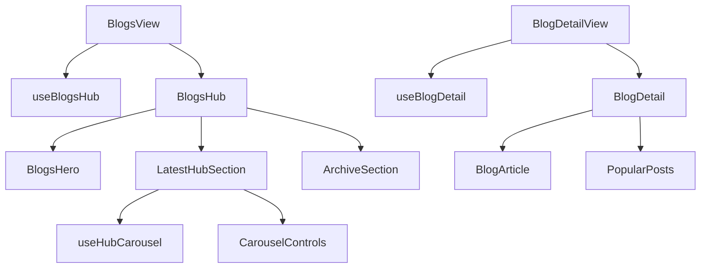

# Blogs module — structure report

The user Knowledge Hub: the blogs page (`/blogs`) with a search hero, a
"Latest From The Hub" strip and a paged "Previous Article" archive, and the
article page (`/blogs/:slug`) with a "Popular Posts" sidebar.

The presentation (hero, carousel, archive, article, popular posts and the
article frame) is shared with the supplier hub and lives in
`@/components/data-display/BlogHub/`. This module owns the data, routing and
role-specific behaviour.

## Folder layout

```
blogs/
├── pages/
│   ├── BlogsView.jsx         /blogs: wires useBlogsHub to the shared BlogsHub
│   └── BlogDetailView.jsx    /blogs/:slug: loading, not found, shared BlogDetail
│
├── index.js                  Public API for code outside blogs (see below)
│
├── constant/
│   └── constants.js          Base path, page size, debounce, popular limit
│
├── hooks/
│   ├── useBlogsHub.js        Debounced search, page, fetch latest + archive, error toast
│   └── useBlogDetail.js      Fetch by slug, not-found tracking, popular posts, error toast
│
├── utils/
│   ├── blogQueries.js        buildLatestBlogsQuery, buildBlogsQuery
│   └── blogCards.js          toBlogCards, popularPosts
│
├── test/
│   ├── BlogViews.test.jsx
│   ├── blogQueries.test.js
│   └── blogCards.test.js
│
└── doc/
    └── STRUCTURE.md
```

Shared presentation (`src/Components/data-display/BlogHub/`):

```
BlogHub/
├── BlogsHub.jsx           Hero + latest + archive; full width, flush top
├── BlogsHero.jsx          Badge, headline, search input, "Explore Articles"
├── LatestHubSection.jsx   Snap carousel on mobile, grid from md up
├── CarouselControls.jsx   Mobile previous / next arrows
├── ArchiveSection.jsx     Paged grid of older articles
├── BlogDetail.jsx         BlogDetail (article + popular rail) and BlogDetailFrame
├── BlogArticle.jsx        Back link, title, meta line, cover image, body
├── PopularPosts.jsx       Sidebar list of other articles
├── useHubCarousel.js      Carousel ref and one-card scroll
└── constants.js           Grid class, section id, carousel sizes
```

The shared components take `basePath` (and `pageSize` for the archive
skeleton) as props; they never read role constants or Redux.

## Layers and rules

| Layer         | Holds                                        | May import                                   |
| ------------- | -------------------------------------------- | -------------------------------------------- |
| `*View.jsx`   | Page wiring; one hook to shared components   | `BlogHub`, hooks, constants                  |
| `hooks/`      | State, effects, dispatch, toasts             | utils, constants, `@/features/dash/user/blogs`    |
| `utils/`      | Pure functions, no React                     | constants, `@/features/dash/user/blogs` mappers   |
| `constant/`   | Static values                                | `@/shared/hooks/usePaginatedList` (page size) |

- One search box drives both the latest strip and the archive; a new search or
  page invalidates the archive list and resets to page 1.
- "Not found" is tracked per slug (`missingSlug === slug`), so it resets when
  the slug changes without a `setState` in an effect.
- `UserLayout` owns `<main>`; the hub renders full width so its hero can span
  edge to edge, and the article uses `BlogDetailFrame` (960px container).

## How the pages work



## Public API (`index.js`)

Routes lazy-load the `*View.jsx` files directly. `index.js` exposes only
`BLOG_BASE_PATH` and `blogDetailPath` for code that links to articles.
Supplier and admin blog pages are separate (`SupplierBlogsView`, `AdminBlogsView`).

## Where to add things

| Change                          | Put it in                                          |
| ------------------------------- | -------------------------------------------------- |
| New hub section (both roles)    | `@/components/data-display/BlogHub/` + `BlogsHub`  |
| New list filter                 | `utils/blogQueries.js` + `useBlogsHub`             |
| New limit, route or magic value | `constant/constants.js`                            |
| Pure data helper                | `utils/` with a test in `test/`                    |
