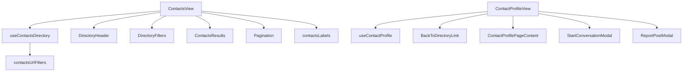

# Contacts module — structure report

The members directory (`/contacts?filter=&country=&q=&page=`) with People,
Pending, Confirm and Connected tabs, and the contact profile page
(`/contacts/:contactId`) with the member's posts, connect and message actions.

## Folder layout

```
contacts/
├── pages/
│   ├── ContactsView.jsx      Directory: header, filters, status line, results, pagination
│   └── ContactProfileView.jsx Profile: loading, not found, profile content, message + report modals
│
├── index.js                  Public API for code outside contacts (see below)
│
├── constant/
│   └── constants.js          Routes, URL params, filter ids + tabs, page size, grid class, empty messages
│
├── components/
│   ├── directory/            Directory page
│   │   ├── DirectoryHeader.jsx      Title and subtitle
│   │   ├── DirectoryFilters.jsx     Filter tabs (Confirm count badge), search, country select
│   │   ├── ContactsResults.jsx      Skeleton, error + retry, empty text, or contact cards
│   │   └── ResultsMessage.jsx       Dashed message box
│   │
│   └── profile/              Profile page
│       ├── ContactProfilePage.jsx   <main> + Container frame
│       └── BackToDirectoryLink.jsx
│
├── hooks/
│   ├── useContactsDirectory.js  URL filters, debounced search, paging, fetch, connect / accept
│   └── useContactProfile.js     Details, author posts, connect, message dialog, report state
│
├── utils/
│   ├── contactsUrlFilters.js    Parse / apply / normalise URL filters, buildContactsQuery
│   └── contactsLabels.js        plural, countLabel, statusLabel, emptyMessage
│
├── test/
│   ├── ContactsView.test.jsx
│   ├── ContactProfileView.test.jsx
│   ├── contactsUrlFilters.test.js
│   └── contactsLabels.test.js
│
└── doc/
    └── STRUCTURE.md
```

## Layers and rules

| Layer         | Holds                                        | May import                                       |
| ------------- | -------------------------------------------- | ------------------------------------------------ |
| `*View.jsx`   | Page layout; wires one hook to components    | components, hooks, utils (labels)                |
| `components/` | Rendering only; no dispatch, no toasts       | utils, constants, shared UI                      |
| `hooks/`      | URL state, effects, dispatch, toasts         | utils, constants, `@/features/dash/user/contacts`, `@/features/dash/user/feed` |
| `utils/`      | Pure functions, no React                     | constants, `@/shared/utils/urlFilters`           |
| `constant/`   | Static values and tab config                 | `lucide-react`, `COUNTRY_OPTIONS`                |

- The URL is the source of truth for filter, country, search and page; invalid
  values are normalised away and an out-of-range page snaps to the last page.
- After connect / accept the card leaves the list, so the hook refetches the
  current query in the background to fill the page.
- "Not found" is tracked per contact id (`notFoundId === contactId`).

## How the pages work



## Public API (`index.js`)

Routes lazy-load the `*View.jsx` files directly. `index.js` exposes only
`CONTACTS_PATH` and `contactProfilePath` for code that links to profiles.

## Where to add things

| Change                          | Put it in                                                     |
| ------------------------------- | ------------------------------------------------------------- |
| New filter tab                  | `FILTER` / `FILTER_TABS` / empty messages + `buildContactsQuery` + `countLabel` |
| New URL filter                  | `constant/constants.js` param + `contactsUrlFilters.js`       |
| New text or count wording       | `utils/contactsLabels.js` with a test                         |
| New limit or magic value        | `constant/constants.js`                                       |

## Refactor summary

| File                     | Before    | After    |
| ------------------------ | --------- | -------- |
| `ContactsView.jsx`       | 354 lines | 61 lines |
| `ContactProfileView.jsx` | 166 lines | 66 lines |

- `contactsUrlFilters.js` moved to `utils/`; its static params and filter ids
  moved to `constant/constants.js`.
- Tests moved to `test/`; added `contactsLabels.test.js`.
