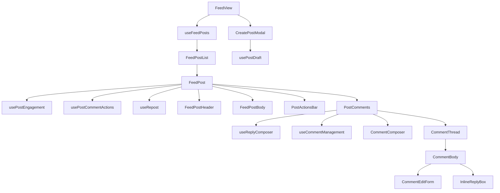

# Feed module — structure report

The home feed: post list, filters, post composer, post cards with reactions,
comments, reposts, reporting and owner edit/delete. Parts of it (post card,
comments, composer) are reused by profiles, supplier ads and the activity tab.

## Folder layout

```
feed/
├── pages/
│   └── FeedView.jsx          Feed page: wires hooks to the list, composer and modals
│
├── index.js                  Public API for code outside the feed (see below)
├── constants.js              Page size, filters, badges, comment/composer limits, accepted file types
│
├── components/
│   ├── FeedPostList.jsx      Loading / error / empty states and the list of FeedPost cards
│   ├── LoadMorePosts.jsx     "Load more" button
│   │
│   ├── post/                 One post card
│   │   ├── FeedPost.jsx          Card container: composes header, body, stats, actions, comments
│   │   ├── FeedPostHeader.jsx        Author, badges, meta, owner menu or report button
│   │   ├── FeedPostBody.jsx          Text, attachment, images, promo pricing, repost body
│   │   ├── PostActionsBar.jsx    PostStats (counts) and PostActions (react / comment / share)
│   │   ├── ReactionButton.jsx    Reaction picker
│   │   ├── PostMeta.jsx          Country · time · Edited line
│   │   ├── PostImageGallery.jsx  Image grid
│   │   ├── AttachmentCard.jsx    Document attachment row
│   │   ├── RepostedPostCard.jsx  Embedded original post inside a repost
│   │   ├── AuthorLink.jsx        Link to the author's profile
│   │   └── OwnerActionsMenu.jsx  Edit / delete menu (posts and comments)
│   │
│   ├── comments/             Comment section
│   │   ├── PostComments.jsx      Container: composer, threads, "See more", delete confirm
│   │   ├── CommentComposer.jsx   Top-level "Add a comment" box
│   │   ├── CommentThread.jsx     Top-level comment + replies with thread lines
│   │   ├── CommentBody.jsx       Bubble, like / reply footer, inline reply box
│   │   ├── CommentEditForm.jsx   In-place editor (Esc / Ctrl+Enter)
│   │   └── InlineReplyBox.jsx    Reply input under a comment
│   │
│   ├── composer/             Creating / editing posts
│   │   ├── FeedComposer.jsx      "Start a post" card on the feed
│   │   ├── FeedFilters.jsx       Filter tabs
│   │   ├── PostTypeChips.jsx     Post type selector
│   │   ├── DraftImageGrid.jsx    Selected images with remove buttons
│   │   ├── DraftDocumentCard.jsx Selected document
│   │   └── ComposerFooter.jsx    Attach buttons, file inputs, Cancel / Publish
│   │
│   └── (modals live in @/components/modals/feed: CreatePostModal, FullCommentsModal,
│        SharePostModal, ReportPostModal)
│
├── hooks/
│   ├── useFeedPosts.js           Fetch, filter, paginate and refresh the feed
│   ├── useCreatePost.js          Open/close the create dialog and publish
│   ├── usePostDeletion.js        Delete-post confirmation flow
│   ├── usePostEngagement.js      Per-card reaction / stats / comments state (optimistic, resets when the post changes)
│   ├── usePostCommentActions.js  Add / like / edit / delete comments for a post
│   ├── useRepost.js              Repost, undo, and why reposting is unavailable
│   ├── useReplyComposer.js       Reply target, @mention pre-fill, expanded threads
│   ├── useCommentManagement.js   Comment edit state and delete confirmation
│   ├── usePostDraft.js           Composer draft, validation, uploads and publish
│   ├── (presence via `useUserPresence` from `@/features/messages`)
│   └── useFocusAtEnd.js          Focus a text field with the caret at the end
│
├── utils/
│   ├── commentTree.js        findComment, findRootId, updateComment, removeComment, selectPreview
│   ├── reactions.js          UI ↔ API reaction mapping, optimistic apply / rollback / reconcile
│   ├── mentions.js           @mention highlighting and mentionFromName
│   ├── postDraft.js          Composer rules: image picking, change detection, labels, upload merge
│   ├── postPayload.js        Composer output → create-post API payload
│   ├── postTypeOptions.js    Post type options for the composer
│   ├── authorProfileHref.js  Profile URL for an author
│   └── formatBytes.js        "1.2 MB" style sizes
│
└── test/
    ├── FeedPost.edit.test.jsx
    ├── FeedPost.repost.test.jsx
    ├── PostComments.test.jsx
    ├── commentTree.test.js
    ├── reactions.test.js
    ├── postDraft.test.js
    └── mentions.test.js
```

## Layers and rules

| Layer          | Holds                                            | May import                               |
| -------------- | ------------------------------------------------ | ---------------------------------------- |
| `components/`  | Rendering and local UI state only                | hooks, utils, constants                  |
| `hooks/`       | State, side effects, Redux dispatches, API calls | utils, constants, `@/features/dash/user/feed` |
| `utils/`       | Pure functions, no React                         | constants                                |
| `constants.js` | Static values and limits                         | nothing                                  |

- Components never dispatch Redux thunks directly for post/comment actions;
  they go through a hook (`usePostEngagement`, `usePostCommentActions`, `useRepost`, ...).
- Feed author online status reuses the messaging realtime presence channel
  (`useMessagesSocket` + `presence:query` / `presence:update`) through
  `useUserPresence`; avatars show the shared `PresenceDot` only for known
  online/offline states.
- Action handlers resolve to `true` / `false` so the UI knows whether to clear
  its input or keep it.
- Optimistic updates (reactions, comment likes) roll back on failure and
  reconcile with the server response on success.
- State copied from props is reset during render (`usePostEngagement`) or by
  remounting (`CreatePostModal`, `InlineReplyBox`) — not with `useEffect`.

## How a post card works



## Public API (`index.js`)

Code outside this folder must import from `@/modules/dash/user/feed` only:

- `FeedPost`
- `PostActions`, `PostStats`
- `PostComments`
- `CreatePostModal`
- `ReportPostModal`
- `LoadMorePosts`

Props of these components are part of the contract; change them only together
with their callers (profiles, supplier ads, activity section).

## Where to add things

| Change                      | Put it in                                                            |
| --------------------------- | -------------------------------------------------------------------- |
| New post type look          | `components/post/FeedPostBody.jsx` (+ badge in `constants.js`)           |
| New post action (e.g. save) | a hook in `hooks/`, button in `PostActionsBar.jsx`                   |
| New comment feature         | `components/comments/` + `useReplyComposer` / `useCommentManagement` |
| New composer attachment     | `usePostDraft.js` + a `Draft*` component + `ComposerFooter.jsx`      |
| New limit or magic number   | `constants.js`                                                       |
| Pure data helper            | `utils/` with a test in `test/`                                      |

## Refactor summary

| File                                      | Before    | After     |
| ----------------------------------------- | --------- | --------- |
| `components/post/FeedPost.jsx`            | 547 lines | 102 lines |
| `components/comments/PostComments.jsx`    | 690 lines | 95 lines  |
| `components/composer/CreatePostModal.jsx` | 449 lines | 160 lines |

- Largest file is now `SharePostModal.jsx` (294 lines); every other file is under 200.
- ESLint is clean for the folder (the previous `set-state-in-effect` error in `FeedPost` is gone).
- All feed tests pass; public exports and props are unchanged.

## Possible next steps

- Split `SharePostModal.jsx` (repost form vs. share options).
- See `docs/audits/feed-module-audit.md` for the audit findings and open risks.
