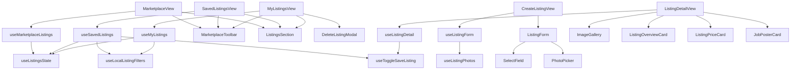

# Marketplace module — structure report

Second-hand lab equipment marketplace: browse (`/marketplace`), saved
(`/marketplace/saved`), my listings (`/marketplace/my-listings`), create / edit
(`/marketplace/create`, `/marketplace/:id/edit`) and listing detail
(`/marketplace/:id`).

## Folder layout

```
marketplace/
├── pages/
│   ├── MarketplaceView.jsx   Browse: toolbar, listing grid, pagination (URL-driven filters)
│   ├── SavedListingsView.jsx Saved listings; un-saving refetches the list
│   ├── MyListingsView.jsx    Own listings with edit / delete
│   ├── CreateListingView.jsx Create and edit form (edit when :listingId is present)
│   └── ListingDetailView.jsx Gallery, overview, price / contact card, seller card
│
├── index.js                  Public API for code outside marketplace (see below)
│
├── constant/
│   └── constants.js          Routes, view keys, page sizes, grid class, form limits, photo limits
│
├── components/
│   ├── toolbar/
│   │   └── MarketplaceToolbar.jsx   Title, Public / Saved / My links (+ Create on My listings), search, category pills
│   │
│   ├── listings/             Shared list rendering
│   │   ├── ListingsSection.jsx      Titled grid with skeleton, error + retry, empty state
│   │   └── ListingsMessage.jsx      Bordered message box (error / empty)
│   │
│   ├── detail/               Listing detail page
│   │   ├── ImageGallery.jsx         Main image, arrows, thumbnail strip, full-screen viewer
│   │   ├── ListingOverviewCard.jsx  Badges, title, description, spec tiles
│   │   ├── SpecTile.jsx
│   │   ├── ListingPriceCard.jsx     Price, save toggle, Edit or Contact / Email / WhatsApp
│   │   ├── ContactLinkButton.jsx    Contact link, or disabled button when unavailable
│   │   └── (seller card: JobPosterCard from user/recruitment, titled "Seller")
│   │
│   ├── form/                 Create / edit form
│   │   ├── ListingForm.jsx          All fields, seller line, submit button
│   │   ├── SelectField.jsx          Labelled select
│   │   └── PhotoPicker.jsx          Hidden file input, previews, add / remove
│   │                         (inputs / labels: @/components/form-controls;
│   │                          ListingFormLoading: @/components/loader/spinners)
│   │
│   └── (DeleteListingModal lives in @/components/modals/marketplace)
│
├── hooks/
│   ├── useMarketplaceListings.js  Browse: URL filters, debounced search, paging, fetch
│   ├── useSavedListings.js        Saved list fetch and un-save
│   ├── useMyListings.js           Own list fetch, edit navigation, delete flow
│   ├── useLocalListingFilters.js  Search / category in component state (saved, mine)
│   ├── useListingsState.js        Store list state as card models; toasts store errors
│   ├── useToggleSaveListing.js    Save / un-save with error toast
│   ├── useListingDetail.js        Fetch / clear listing, gallery index, contact dialog
│   ├── useListingForm.js          Load for edit, validate, upload photos, create / update
│   └── useListingPhotos.js        Photo list, blob previews and cleanup
│
├── utils/
│   ├── marketplaceUrlFilters.js   CATEGORY_PARAM, DEFAULT_CATEGORY, marketplaceFilters
│   ├── listingQueries.js          buildListingsQuery, buildMineQuery, buildSavedQuery
│   ├── listingForm.js             Empty form, API ⇄ form mapping, validation, seller line, submit label
│   ├── listingPhotos.js           Photo ids, blob revoke, file screening, existing / new split
│   └── listingDetail.js           Gallery images, seller profile link, viewer state
│
├── test/
│   ├── MarketplaceView.test.jsx
│   ├── CreateListingView.test.jsx
│   ├── ListingDetailView.test.jsx
│   ├── marketplaceUrlFilters.test.js
│   ├── listingQueries.test.js
│   ├── listingForm.test.js
│   ├── listingPhotos.test.js
│   └── listingDetail.test.js
│
└── doc/
    └── STRUCTURE.md
```

## Layers and rules

| Layer         | Holds                                            | May import                                        |
| ------------- | ------------------------------------------------ | ------------------------------------------------- |
| `*View.jsx`   | Page layout; wires one hook to components        | components, hooks, constants                      |
| `components/` | Rendering only; no dispatch, no toasts           | utils, constants, shared UI                       |
| `hooks/`      | State, effects, dispatch, navigation, toasts     | utils, constants, `@/features/dash/user/marketplace`   |
| `utils/`      | Pure functions, no React                         | constants, `@/features/dash/user/marketplace` mappers  |
| `constant/`   | Static values                                    | `@/shared/hooks/usePaginatedList` (page size)     |

- Browse keeps category, search and page in the URL; Saved and My listings keep
  them in component state and load one page of `PERSONAL_LISTINGS_PAGE_SIZE`.
- The detail gallery index is keyed to the listing and resets during render when
  the listing changes (no `setState` in an effect).
- Pages render inside `DashboardPage` (`@/components/layout/DashboardPage`);
  `UserLayout` owns the `<main>` landmark. Modals are fixed-position, so they
  can sit inside the page frame.

## How the pages work



## Public API (`index.js`)

Routes lazy-load the `*View.jsx` files directly. `index.js` exposes only the
route paths (`MARKETPLACE_PATH`, `MY_LISTINGS_PATH`, `SAVED_LISTINGS_PATH`,
`CREATE_LISTING_PATH`, `listingDetailPath`, `editListingPath`) for code outside
this folder that links into the marketplace. Nothing outside imports components.

## Where to add things

| Change                           | Put it in                                             |
| -------------------------------- | ----------------------------------------------------- |
| New form field                   | `ListingForm.jsx` + `emptyListingForm` / `listingToForm` / `validateListingForm` |
| New list filter                  | `listingQueries.js` (+ `marketplaceUrlFilters.js` for browse) |
| New limit, route or magic value  | `constant/constants.js`                               |
| Pure data helper                 | `utils/` with a test in `test/`                       |

## Refactor summary

| File                    | Before    | After    |
| ----------------------- | --------- | -------- |
| `MarketplaceView.jsx`   | 187 lines | 52 lines |
| `SavedListingsView.jsx` | 118 lines | 35 lines |
| `MyListingsView.jsx`    | 167 lines | 51 lines |
| `CreateListingView.jsx` | 550 lines | 60 lines |
| `ListingDetailView.jsx` | 453 lines | 80 lines |

- `components/marketplace/MarketplaceToolbar.jsx` moved to `components/toolbar/`.
- The three query builders and the duplicated grid / skeleton / empty markup are now shared.
- Fixed the existing `react-hooks/set-state-in-effect` lint error in the detail page.
