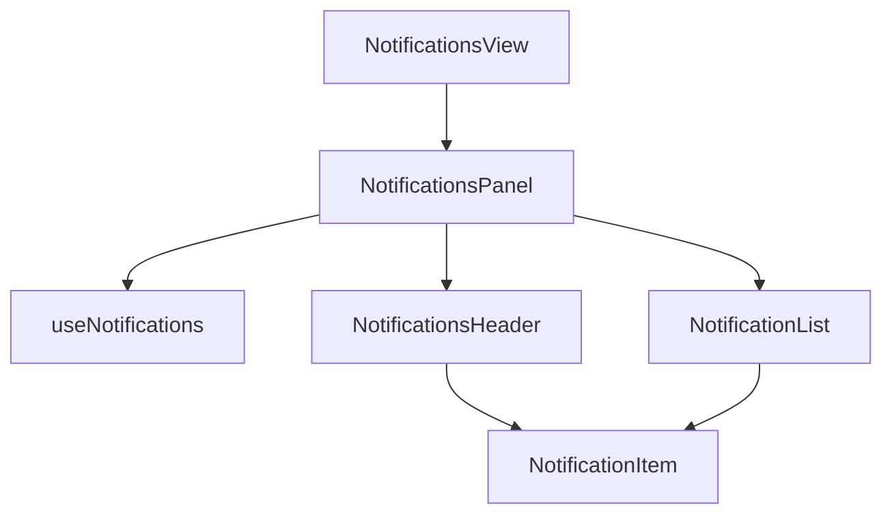

# Notifications module — structure report

The user notifications page (`/notifications`): a card with "Mark all as read"
and the latest 30 notifications. Opening one marks it read and follows its link
(chat links are resolved to a live conversation).

## Folder layout

```
notifications/
├── pages/
│   └── NotificationsView.jsx Page frame (narrow Container) around NotificationsPanel
│
├── index.js                  Public API for code outside notifications (see below)
│
├── constant/
│   └── constants.js          Route, list query (page 1, 30, newest first), skeleton count
│
├── components/
│   └── list/
│       ├── NotificationsPanel.jsx   Card wired to useNotifications (public, reusable)
│       ├── NotificationsHeader.jsx  Title and "Mark all as read"
│       ├── NotificationList.jsx     Skeleton on first load, empty text, or rows
│       └── NotificationItem.jsx     Icon tile, title, subtitle, time, unread dot
│
├── hooks/
│   └── useNotifications.js   Fetch list, error toast, open (mark read + navigate), mark all read
│
├── test/
│   └── NotificationsView.test.jsx
│
└── doc/
    └── STRUCTURE.md
```

There is no `utils/` folder: mapping lives in `@/features/dash/user/notifications`
(`toNotificationListModel`) and link resolution in `@/features/messages`.

## Layers and rules

| Layer         | Holds                                           | May import                                                |
| ------------- | ----------------------------------------------- | --------------------------------------------------------- |
| `*View.jsx`   | Page frame                                      | components                                                |
| `components/` | Rendering; `NotificationsPanel` alone calls the hook so it can be dropped into any layout | hooks (panel only), constants |
| `hooks/`      | Fetching, dispatch, navigation, toasts          | constants, `@/features/dash/user/notifications`, `@/features/messages` |
| `constant/`   | Static values                                   | —                                                         |

## How the page works



## Public API (`index.js`)

- `NotificationsPanel` — reusable notifications card for other layouts.
  No props; needs the `userNotifications` store slice and a router.

The route lazy-loads `NotificationsView.jsx` directly.

## Where to add things

| Change                          | Put it in                                    |
| ------------------------------- | -------------------------------------------- |
| New row field or badge          | `NotificationItem.jsx` (+ mapper in features) |
| New list action                 | `useNotifications.js` + `NotificationsHeader` |
| Page size or other magic value  | `constant/constants.js`                      |

## Refactor summary

- `shared/pages/notifications/NotificationsPageContent.jsx` (162 lines) moved here
  and split into the panel, header, list, item and `useNotifications`.
- Its unused "controlled" mode (`items` / `loading` / `onMarkRead` /
  `onMarkAllRead` props) was removed; nothing passed them.
