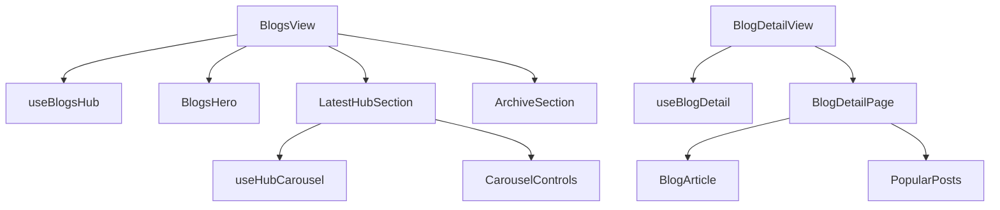

# Blogs module — structure report

The user Knowledge Hub: the blogs page (`/blogs`) with a search hero, a
"Latest From The Hub" strip and a paged "Previous Article" archive, and the
article page (`/blogs/:slug`) with a "Popular Posts" sidebar.

## Folder layout

```
blogs/
├── BlogsView.jsx             /blogs: wires useBlogsHub to the hero, latest and archive sections
├── BlogDetailView.jsx        /blogs/:slug: loading, not found, article + popular posts
├── index.js                  Public API for code outside blogs (see below)
│
├── constant/
│   └── constants.js          Routes, page size, grid class, debounce, carousel sizes, popular limit
│
├── components/
│   ├── hub/                  Blogs page sections
│   │   ├── BlogsHero.jsx            Badge, headline, search input, "Explore Articles"
│   │   ├── LatestHubSection.jsx     Snap carousel on mobile, grid from md up
│   │   ├── CarouselControls.jsx     Mobile previous / next arrows
│   │   └── ArchiveSection.jsx       Paged grid of older articles
│   │
│   ├── detail/               Article page
│   │   ├── BlogArticle.jsx          Back link, title, meta line, cover image, body
│   │   └── PopularPosts.jsx         Sidebar list of other articles
│   │
│   └── layout/
│       └── BlogDetailPage.jsx       Narrow page frame for the article and its skeleton
│
├── hooks/
│   ├── useBlogsHub.js        Debounced search, page, fetch latest + archive, error toast
│   ├── useHubCarousel.js     Carousel ref and one-card scroll
│   └── useBlogDetail.js      Fetch by slug, not-found tracking, popular posts, error toast
│
├── utils/
│   ├── blogQueries.js        buildLatestBlogsQuery, buildBlogsQuery
│   └── blogCards.js          toBlogCards, popularPosts
│
├── test/
│   ├── BlogViews.test.jsx
│   ├── blogQueries.test.js
│   └── blogCards.test.js
│
└── doc/
    └── STRUCTURE.md
```

## Layers and rules

| Layer         | Holds                                        | May import                                   |
| ------------- | -------------------------------------------- | -------------------------------------------- |
| `*View.jsx`   | Page layout; wires one hook to components    | components, hooks                            |
| `components/` | Rendering only; no dispatch, no toasts       | UI hooks (`useHubCarousel`), constants       |
| `hooks/`      | State, effects, dispatch, toasts             | utils, constants, `@/features/dash/user/blogs`    |
| `utils/`      | Pure functions, no React                     | constants, `@/features/dash/user/blogs` mappers   |
| `constant/`   | Static values                                | `@/shared/hooks/usePaginatedList` (page size) |

- One search box drives both the latest strip and the archive; a new search or
  page invalidates the archive list and resets to page 1.
- "Not found" is tracked per slug (`missingSlug === slug`), so it resets when
  the slug changes without a `setState` in an effect.

## How the pages work



## Public API (`index.js`)

Routes lazy-load the `*View.jsx` files directly. `index.js` exposes only
`BLOG_BASE_PATH` and `blogDetailPath` for code that links to articles. The
shared supplier/admin blog pages live in `@/shared/pages/blogs` and are separate.

## Where to add things

| Change                          | Put it in                                     |
| ------------------------------- | --------------------------------------------- |
| New hub section                 | `components/hub/` + render it in `BlogsView`  |
| New list filter                 | `utils/blogQueries.js` + `useBlogsHub`        |
| New limit, route or magic value | `constant/constants.js`                       |
| Pure data helper                | `utils/` with a test in `test/`               |

## Refactor summary

| File                 | Before    | After    |
| -------------------- | --------- | -------- |
| `BlogsView.jsx`      | 283 lines | 26 lines |
| `BlogDetailView.jsx` | 166 lines | 35 lines |

- Fixed the existing `react-hooks/set-state-in-effect` lint error in the article page.
