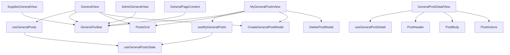

# General module — structure report

Community news and documents: browse (`/general`), my posts
(`/general/my-posts`) with create / edit / delete, and the post page
(`/general/:postId`). The toolbar is shared with the supplier and admin
General pages.

## Folder layout

```
general/
├── GeneralView.jsx            Browse: toolbar, post grid, create modal
├── MyGeneralPostsView.jsx     Own posts: toolbar, grid with edit / delete, create-edit + delete modals
├── GeneralPostDetailView.jsx  Post page: loading, not found, header, body, actions
├── index.js                   Public API for code outside general (see below)
│
├── constant/
│   └── constants.js           Routes, toolbar view keys, default category, page size, grid class, post types
│
├── components/
│   ├── toolbar/
│   │   └── GeneralToolbar.jsx       Header, All / My / Create buttons, category pills
│   │
│   ├── posts/                Shared list rendering
│   │   ├── PostsGrid.jsx            Skeleton, empty state, or cards + pagination
│   │   └── PostsEmptyState.jsx
│   │
│   ├── detail/               Post page
│   │   ├── PostHeader.jsx           Cover, type badge, title, date, category
│   │   ├── PostBody.jsx             Paragraphs, or the summary when there is no body
│   │   └── PostActions.jsx          Download (documents) and Share
│   │
│   ├── layout/
│   │   └── GeneralPage.jsx          <main> + Container frame
│   │
│   └── modals/
│       └── DeletePostModal.jsx
│
├── hooks/
│   ├── useGeneralPosts.js       Browse: category, page, fetch, create
│   ├── useMyGeneralPosts.js     Mine: category, page, fetch, create / edit modal, delete flow
│   ├── useGeneralPostsState.js  Store list state as card models; toasts store errors
│   └── useGeneralPostDetail.js  Fetch by id, not-found tracking, share link
│
├── utils/
│   ├── generalQueries.js     buildPostsQuery
│   └── postForm.js           buildPostPayload (validation + edit image clearing)
│
├── test/
│   ├── GeneralViews.test.jsx
│   └── generalUtils.test.js
│
└── doc/
    └── STRUCTURE.md
```

## Layers and rules

| Layer         | Holds                                       | May import                                    |
| ------------- | ------------------------------------------- | --------------------------------------------- |
| `*View.jsx`   | Page layout; wires one hook to components   | components, hooks, constants, shared modal    |
| `components/` | Rendering only; no dispatch, no toasts      | constants, `@/modules/dash/user/data/general`      |
| `hooks/`      | State, effects, dispatch, toasts            | utils, constants, `@/features/dash/user/general`   |
| `utils/`      | Pure functions, no React                    | constants, `@/features/dash/user/general` mappers  |
| `constant/`   | Static values                               | `@/shared/hooks/usePaginatedList` (page size) |

- Changing the category resets to page 1 in the same handler (no effect).
- "Not found" is tracked per post id (`missingId === postId`), so it resets
  when the id changes.
- The create / edit modal is `@/shared/pages/general/CreateGeneralPostModal`,
  shared with supplier and admin; it is not part of this module.

## How the pages work



## Public API (`index.js`)

Code outside this folder imports from `@/modules/dash/user/pages/general` only:

- `GeneralToolbar` — used by `SupplierGeneralView`, `SupplierMyGeneralPostsView`,
  `AdminGeneralView` and `shared/pages/general/GeneralPageContent`. Its props
  (`activeView` `'browse' | 'mine'`, `browseHref`, `myPostHref`, `show*`) are part
  of the contract; change them together with those pages.

Routes lazy-load the `*View.jsx` files directly.

## Where to add things

| Change                          | Put it in                                         |
| ------------------------------- | ------------------------------------------------- |
| New post validation rule        | `utils/postForm.js` with a test                   |
| New list filter                 | `utils/generalQueries.js` + the list hooks        |
| New post type                   | `POST_TYPE` / `POST_TYPE_STYLES` in constants     |
| New limit, route or magic value | `constant/constants.js`                           |

## Refactor summary

| File                        | Before    | After    |
| --------------------------- | --------- | -------- |
| `GeneralView.jsx`           | 145 lines | 47 lines |
| `MyGeneralPostsView.jsx`    | 247 lines | 60 lines |
| `GeneralPostDetailView.jsx` | 152 lines | 46 lines |

- `components/general/GeneralToolbar.jsx` moved to `components/toolbar/`; outside
  callers now use `index.js`.
- The duplicated grid / skeleton / empty markup, query builder and post
  validation are shared.
- Fixed the existing `react-hooks/set-state-in-effect` lint error in `GeneralView`.
