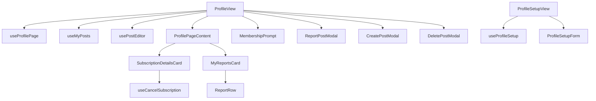

# Profile module — structure report

The signed-in user's own profile (`/profile`): hero, subscription details,
"My Posts" activity with edit / report / delete, and submitted reports; plus the
edit-profile form (`/profile/setup`). The subscription card is reused by the
admin user detail page.

## Folder layout

```
profile/
├── pages/
│   ├── ProfileView.jsx       /profile: wires hooks to ProfilePageContent, cards and modals
│   └── ProfileSetupView.jsx  Edit-profile form page
│
├── index.js                  Public API for code outside profile (see below)
│
├── constant/
│   └── constants.js          Routes, paid membership statuses, reports query, subscription defaults / colours, image types
│
├── components/
│   ├── setup/
│   │   └── ProfileSetupForm.jsx    Edit-profile form (also used by the supplier profile page)
│   │
│   ├── subscription/
│   │   └── SubscriptionDetailsCard.jsx  Plan details and Cancel Subscription
│   │
│   ├── reports/              "My reports" sidebar
│   │   ├── MyReportsCard.jsx       Loading / empty states and the list
│   │   └── ReportRow.jsx           Reason · type, snippet, date, status
│   │
│   └── layout/
│       └── MembershipPrompt.jsx    "Want full access?" link for inactive accounts
│                             (DeletePostModal: @/components/modals/common/DeletePostModal;
│                              ProfileSetupLoading: @/components/loader/spinners)
│
├── hooks/
│   ├── useProfilePage.js         Load profile + reports, error toasts, premium / subscription flags
│   ├── useMyPosts.js             My posts: load, load more, report target, delete flow
│   ├── useCancelSubscription.js  Confirm dialog and cancel the signed-in subscription
│   └── useProfileSetup.js        Load form, field changes, avatar / cover upload, validate and save
│
├── utils/
│   ├── membership.js         showsSubscriptionCard
│   ├── subscription.js       Defaults, status key / colour, can-cancel, detail rows
│   └── profileSetup.js       Country options, image type check, form validation
│
└── test/
    ├── membership.test.js
    ├── subscription.test.js
    └── profileSetup.test.js
```

Post editing reuses `usePostEditor` (`@/modules/dash/user/feed/hooks/usePostEditor`) and the feed's
`CreatePostModal` / `ReportPostModal` from `@/modules/dash/user/feed`.

## Layers and rules

| Layer         | Holds                                            | May import                                                     |
| ------------- | ------------------------------------------------ | -------------------------------------------------------------- |
| `*View.jsx`   | Page layout; wires hooks to components           | components, hooks, feed public API                             |
| `components/` | Rendering and local UI state only                | hooks (cancel subscription), utils, constants                  |
| `hooks/`      | State, side effects, Redux dispatches, API calls | utils, constants, `@/features/dash/user/{profile,feed,reports,subscriptions}` |
| `utils/`      | Pure functions, no React                         | constants                                                      |
| `constant/`   | Static values                                    | nothing                                                        |

- Components never dispatch; `SubscriptionDetailsCard` cancels through
  `useCancelSubscription`, the views go through their page hooks.
- Errors from the profile, reports and posts slices are shown as toasts by the
  hook that loads them.

## How the pages work



## Public API (`index.js`)

Code outside this folder must import from `@/modules/dash/user/profile` only:

- `SubscriptionDetailsCard` (props: `subscription`, `manageable`, `accent`),
  used by `AdminUserDetailView`
- `ProfileSetupForm`, used by `SupplierProfileView`

The routes
lazy-load the `*View.jsx` files directly.

## Where to add things

| Change                          | Put it in                                                   |
| ------------------------------- | ----------------------------------------------------------- |
| New subscription detail row     | `subscriptionRows` in `utils/subscription.js`               |
| New membership rule             | `utils/membership.js` (+ status list in `constant/`)        |
| New profile form rule           | `utils/profileSetup.js` + `useProfileSetup.js`              |
| New profile sidebar card        | `components/<area>/` + its data in `useProfilePage.js`      |
| New limit or magic value        | `constant/constants.js`                                     |
| Pure data helper                | `utils/` with a test in `test/`                             |

## Refactor summary

| File                      | Before                         | After     |
| ------------------------- | ------------------------------ | --------- |
| `ProfileView.jsx`         | 212 lines                      | 95 lines  |
| `ProfileSetupView.jsx`    | 121 lines                      | 32 lines  |
| `ProfileSections.jsx`     | 192 lines (two cards, dispatch) | split into `SubscriptionDetailsCard` (75), `MyReportsCard` (34), `ReportRow` (22) |

- `components/profile/` was merged into this folder; outside callers now use `index.js`.
- The unused `ProfileHero` / `InfoTile` / `ContactInfoCard` / `ProfessionalInfoCard`
  re-exports from `ProfileSections.jsx` were dropped; import them from
  `@/components/data-display/ProfileHero/ProfileHero`.
- Every file is under 100 lines.
