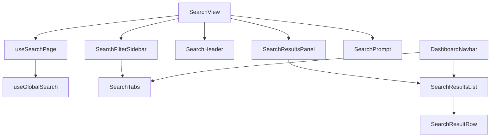

# Search module — structure report

The global search page (`/search?q=&tab=`): category tabs, grouped results for
people, jobs, listings, posts and blogs, with loading, error and empty states.
The tabs and results list are also used by the navbar search dropdown.

## Folder layout

```
search/
├── pages/
│   └── SearchView.jsx        /search page: wires useSearchPage to the sidebar, header and results
│
├── index.js                  Public API for code outside search (see below)
│
├── constant/
│   └── constants.js          Route, URL params, tabs, result groups, icons, tile colours, limits
│
├── components/
│   ├── tabs/
│   │   └── SearchTabs.jsx          Category tabs, horizontal (navbar) or vertical (page)
│   │
│   ├── results/              Result rendering
│   │   ├── SearchResultsPanel.jsx  Error with retry, or the list (dimmed while refreshing)
│   │   ├── SearchResultsList.jsx   Groups for the active tab, "See all", empty / searching text
│   │   └── SearchResultRow.jsx     Avatar or type tile, title, details
│   │
│   └── layout/               Page sections (the frame is @/components/layout/DashboardPage)
│       ├── SearchFilterSidebar.jsx "Filter results" card with vertical tabs
│       ├── SearchHeader.jsx        Title and "Showing … for “query”"
│       └── SearchPrompt.jsx        Shown before a query is entered
│
├── hooks/
│   └── useSearchPage.js      Query and tab from the URL, fetch results, change tab, open a result
│
├── utils/
│   ├── searchTabs.js         isSearchTab, searchTabLabel, buildSearchPath, withSearchTab
│   └── searchResults.js      toSearchGroups, filterSearchGroups, searchResultHref, searchResultDisplay
│
└── test/
    ├── searchTabs.test.js
    └── searchResults.test.js
```

## Layers and rules

| Layer         | Holds                                          | May import                                  |
| ------------- | ---------------------------------------------- | ------------------------------------------- |
| `SearchView`  | Page layout; wires the hook to components      | components, hooks, constants                |
| `components/` | Rendering only                                 | utils, constants                            |
| `hooks/`      | URL state, fetching, navigation                | utils, constants, `@/features/dash/user/search`  |
| `utils/`      | Pure functions, no React                       | constants, `@/modules/dash/user/data/marketplace` |
| `constant/`   | Static values, tab/group config, icon map      | `lucide-react` only                         |

- The URL is the source of truth: `q` is the query, `tab` the category; the
  default tab ("all") is never written to the URL.
- Fetching goes through `useGlobalSearch` from `@/features/dash/user/search`;
  components never dispatch.
- Posts appear as a group on "All" but have no tab and no "See all".

## How the page works



## Public API (`index.js`)

Code outside this folder must import from `@/modules/dash/user/search` only:

- `SearchTabs`, `SearchResultsList`
- `DEFAULT_SEARCH_TAB`, `SEARCH_PATH`
- `buildSearchPath`, `toSearchGroups`

Used by `DashboardNavbar` (search input + dropdown). Props of these components
are part of the contract; change them together with the navbar. The route
lazy-loads `SearchView.jsx` directly.

## Where to add things

| Change                         | Put it in                                                          |
| ------------------------------ | ------------------------------------------------------------------ |
| New result type                | `SEARCH_GROUPS` / icon / tile in `constant/constants.js` + `searchResultHref` and `searchResultDisplay` |
| New tab                        | `SEARCH_TABS` in `constant/constants.js`                           |
| New limit or magic value       | `constant/constants.js`                                            |
| Pure data helper               | `utils/` with a test in `test/`                                    |

## Refactor summary

| File                    | Before    | After    |
| ----------------------- | --------- | -------- |
| `SearchView.jsx`        | 130 lines | 39 lines |
| `SearchResultsList.jsx` | 115 lines | 70 lines |

- `components/search/` was merged into this folder; the navbar now uses `index.js`.
- `searchResults.js` was split into `constant/constants.js`, `utils/searchTabs.js`
  and `utils/searchResults.js`.
