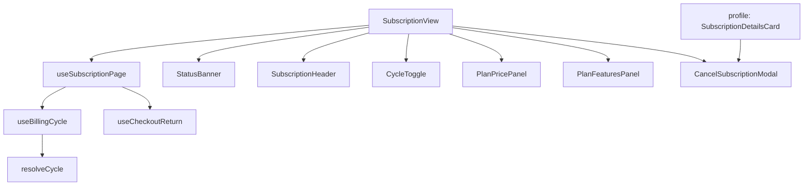

# Subscription module — structure report

The membership page (`/subscription`): status banner, billing-cycle toggle,
plan card with Stripe checkout and cancel, billing history with Stripe
invoices (`PaymentHistoryCard` from `@/components/payments`, anchor
`#billing-history`), and handling of the Stripe return
(`?checkout=success&session_id=…` / `?checkout=cancelled`).

## Folder layout

```
subscription/
├── pages/
│   └── SubscriptionView.jsx   Page: banner, header, plans loading / error, cycle toggle, plan card, cancel modal
│
├── index.js                   Public API for code outside subscription (see below)
│
├── constant/
│   └── constants.js           Routes, checkout params, statuses, cycles + API plan names, banner tones, perks
│
├── components/
│   ├── status/
│   │   └── StatusBanner.jsx         Trial / active / cancelling / ended pill
│   │
│   ├── layout/
│   │   └── SubscriptionHeader.jsx   Title, subtitle, Stripe-not-configured warning
│   │
│   ├── plans/                Plan selection and card
│   │   ├── CycleToggle.jsx          Monthly / Yearly switch
│   │   ├── PlanPricePanel.jsx       Price, perks, subscribe and cancel buttons
│   │   └── PlanFeaturesPanel.jsx    Included features, "membership ended" note, profile link
│   │
│   └── (CancelSubscriptionModal lives in @/components/modals/subscription; also used by the profile page)
│
├── hooks/
│   ├── useSubscriptionPage.js  Fetch plans / subscription / profile, derived state, checkout, cancel
│   ├── useBillingCycle.js      Selected cycle; resets to the member's plan when it changes
│   └── useCheckoutReturn.js    One-time Stripe return handling and refresh
│
├── utils/
│   ├── plans.js                toPlanOptions, planFeatures, toApiPlan, subscriptionCycle, resolveCycle
│   └── subscriptionStatus.js   isAlreadyOnPlan, canCancel, showCancelButton, hasMembershipEnded,
│                               subscribeLabel, cancelSuccessMessage, statusBanner
│
├── test/
│   ├── SubscriptionView.test.jsx
│   ├── plans.test.js
│   └── subscriptionStatus.test.js
│
└── doc/
    └── STRUCTURE.md
```

## Layers and rules

| Layer         | Holds                                        | May import                                                  |
| ------------- | -------------------------------------------- | ----------------------------------------------------------- |
| `*View.jsx`   | Page layout; wires one hook to components    | components, hooks                                           |
| `components/` | Rendering only; no dispatch, no toasts       | utils, constants                                            |
| `hooks/`      | State, effects, dispatch, toasts, redirects  | utils, constants, `@/features/dash/user/subscriptions`, `@/features/dash/user/profile` |
| `utils/`      | Pure functions, no React                     | constants, subscription mappers                             |
| `constant/`   | Static values                                | `lucide-react`, `SUPPORT_CONTACT`                           |

- The billing cycle is derived, not synced with effects: the user's choice,
  else the member's current plan, else monthly; if the server doesn't offer
  that cycle, the first offered plan is used.
- The Stripe return is handled once per mount (ref guard) after the initial
  fetches, then the URL params are cleared.

## How the page works



## Public API (`index.js`)

- `CancelSubscriptionModal` — used by `pages/profile/components/subscription/SubscriptionDetailsCard`.
  Props: `open`, `isTrial`, `saving`, `onClose`, `onConfirm`.

The route lazy-loads `SubscriptionView.jsx` directly.

## Where to add things

| Change                          | Put it in                                             |
| ------------------------------- | ----------------------------------------------------- |
| New status or banner wording    | `utils/subscriptionStatus.js` (+ tone in constants) with a test |
| New billing cycle               | `CYCLE` / `PLAN_API` in constants + `subscriptionCycle` |
| New perk line                   | `PLAN_PERKS` in constants                             |
| New limit, route or magic value | `constant/constants.js`                               |

## Refactor summary

| File                   | Before    | After    |
| ---------------------- | --------- | -------- |
| `SubscriptionView.jsx` | 391 lines | 66 lines |

- `components/subscription/CancelSubscriptionModal.jsx` moved to `components/modals/`;
  the profile page now imports it from `index.js`.
- Fixed the two existing `react-hooks/set-state-in-effect` lint errors (cycle syncing).
