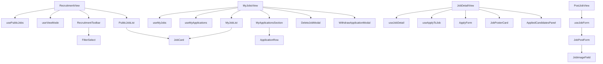

# Recruitment module — structure report

The user recruitment pages: public job posts (search, filters, list/grid),
the caller's own job posts and applications, the job detail page with in-app
apply and the owner's candidate panel, and the create/edit job form. Parts of
it (toolbar, section header, job form, poster card, candidate panel) are
reused by the supplier and admin job pages.

## Folder layout

```
recruitment/
├── RecruitmentView.jsx       Public Job Posts: toolbar filters, list/grid toggle, list, pagination
├── MyJobsView.jsx            My Job Posts (status tabs, Post Job) and My Applications
├── JobDetailView.jsx         Job detail, apply form, poster card, owner's candidates
├── PostJobView.jsx           Create / edit job form
├── index.js                  Public API for code outside recruitment (see below)
│
├── constant/
│   └── constants.js          Routes, page sizes, view mode, debounce, cancellable statuses
│
├── components/
│   ├── toolbar/              Page header + search row
│   │   ├── RecruitmentToolbar.jsx  Title, Public / My Job Posts links, search, filters slot
│   │   ├── FilterSelect.jsx        Dropdown with an "All …" first option
│   │   └── ViewModeToggle.jsx      List / grid buttons
│   │
│   ├── jobs/                 Job lists
│   │   ├── JobsSectionHeader.jsx   Section title, count, right-hand slot
│   │   ├── PublicJobList.jsx       Loading / error / empty states, list or grid of JobCard
│   │   └── MyJobList.jsx           Loading / empty states, owner JobCards (edit, close, delete)
│   │
│   ├── applications/         The caller's applications
│   │   ├── MyApplicationsSection.jsx  Header with Applied / Cancelled tabs and the rows
│   │   └── ApplicationRow.jsx         Job, status, View and Cancel
│   │
│   ├── detail/               Job detail page parts
│   │   ├── JobPosterCard.jsx       Who posted the job
│   │   └── ApplyForm.jsx           Cover letter + submit
│   │
│   ├── form/                 Create / edit job
│   │   ├── JobPostForm.jsx         All job fields
│   │   └── JobImageField.jsx       Logo upload / remove
│   │
│   ├── candidates/           Owner's view of applicants
│   │   ├── AppliedCandidatesPanel.jsx  Sidebar list, opens the modals below
│   │   ├── AllCandidatesModal.jsx      Every applicant
│   │   ├── ApplicantDetailsModal.jsx   One applicant with cover letter
│   │   └── CandidateRow.jsx            Applicant row
│   │
│   └── modals/
│       ├── DeleteJobModal.jsx           Confirm deleting a job post
│       └── WithdrawApplicationModal.jsx Confirm withdrawing an application
│
├── hooks/
│   ├── usePublicJobs.js      URL filters (?page, level, type, workplace, q), debounced search, fetch, paging
│   ├── useViewMode.js        List / grid preference in localStorage
│   ├── useMyJobs.js          Own jobs: search, status tab, paging, open/close, delete flow
│   ├── useMyApplications.js  Own applications: Applied / Cancelled tab, withdraw flow
│   ├── useJobDetail.js       Load a job, not-found, owner check, owner's applications
│   ├── useApplyToJob.js      Apply form open/close, cover letter, submit
│   └── useJobForm.js         Load for edit, field changes, logo upload, validate and save
│
├── utils/
│   ├── jobsSection.js        buildPublicJobsQuery, buildMyJobsQuery, jobCount, status helpers
│   ├── recruitmentUrlFilters.js  URL params, filter options, publicJobFilters
│   ├── jobForm.js            Empty form, postable levels, payload validation
│   └── candidates.js         Applicant model, status pill classes, sort by first applied
│
└── test/
    ├── RecruitmentView.test.jsx
    ├── JobPostForm.test.jsx
    ├── ApplicantDetailsModal.test.jsx
    ├── AppliedCandidatesPanel.test.jsx
    ├── jobsSection.test.js
    ├── recruitmentUrlFilters.test.js
    └── jobForm.test.js
```

## Layers and rules

| Layer          | Holds                                            | May import                                      |
| -------------- | ------------------------------------------------ | ----------------------------------------------- |
| `*View.jsx`    | Page layout; wires hooks to components           | components, hooks, utils, constants             |
| `components/`  | Rendering and local UI state only                | utils, constants                                |
| `hooks/`       | State, side effects, Redux dispatches, API calls | utils, constants, `@/features/user/recruitment` |
| `utils/`       | Pure functions, no React                         | `@/features/user/recruitment` mappers, shared constants |
| `constant/`    | Static values and limits                         | nothing                                         |

- Components never dispatch Redux thunks; job, application and apply actions go
  through a hook (`useMyJobs`, `useMyApplications`, `useApplyToJob`, `useJobForm`).
- Public Job Posts keeps its filters in the URL so refresh, links and Back work;
  My Job Posts keeps search and status in local state.
- Filter values in the UI are labels ("Contract", "Remote"); `utils/jobsSection.js`
  maps them to API enums. "All" sends no param.

## How the pages work



## Public API (`index.js`)

Code outside this folder must import from `@/modules/user/pages/recruitment` only:

- `RecruitmentToolbar`, `JobsSectionHeader`
- `JobPostForm`
- `JobPosterCard`, `AppliedCandidatesPanel`
- `buildMyJobsQuery`, `jobCount`, `matchesStatusFilter`, `nextJobStatus`

Used by `SupplierRecruitmentView`, `SupplierMyJobsView`, `SupplierPostJobView`,
`SupplierJobDetailView` and `AdminJobDetailView`. Props of these components are
part of the contract; change them only together with those callers. Routes
lazy-load the `*View.jsx` files directly.

## Where to add things

| Change                          | Put it in                                                       |
| ------------------------------- | --------------------------------------------------------------- |
| New public job filter           | `utils/recruitmentUrlFilters.js` + `buildPublicJobsQuery` + a `FilterSelect` in the toolbar |
| New job card action (owner)     | `useMyJobs.js` + `MyJobList.jsx` / `JobCard`                    |
| New job form field              | `utils/jobForm.js` (default + validation) + `JobPostForm.jsx`   |
| New applicant info              | `utils/candidates.js` + `components/candidates/`                |
| New route, limit or magic value | `constant/constants.js`                                         |
| Pure data helper                | `utils/` with a test in `test/`                                 |

## Refactor summary

| File                  | Before    | After     |
| --------------------- | --------- | --------- |
| `MyJobsView.jsx`      | 460 lines | 111 lines |
| `RecruitmentView.jsx` | 246 lines | 74 lines  |
| `JobDetailView.jsx`   | 228 lines | 97 lines  |
| `PostJobView.jsx`     | 187 lines | 71 lines  |

- `components/recruitment/` was merged into this folder; outside callers now use `index.js`.
- `recruitmentFilters` (level + search only) was removed; it had no callers left
  after Public Job Posts moved to `publicJobFilters`.
- Largest file is `JobPostForm.jsx` (312 lines); every other file is under 160.

## Possible next steps

- Split `JobPostForm.jsx` (basics, details, requirements).
- The supplier job pages repeat much of `useMyJobs` / `usePublicJobs`; they could
  reuse these hooks once their Redux slice and routes are parameterised.
